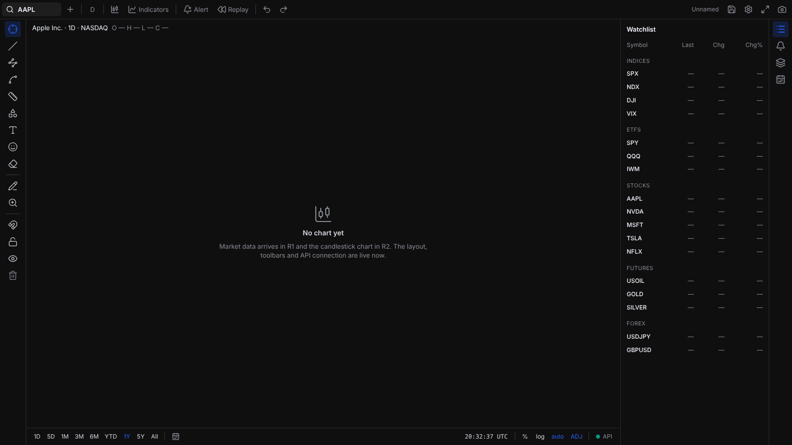

# ChartLab

A personal, local, TradingView-style charting, analysis and research platform: candles, indicators, drawing tools,
gap detection and bar replay — built so that education pages, custom indicators, backtesting and a **paper-only**
trading agent can plug in later.

> **Status:** Phase 1 (R0–R7) complete — 29 indicators: the moving-average family plus Bollinger Bands, RSI, MACD,
> Stochastic, ATR, OBV, VWAP, Volume SMA, previous-period levels and pivots, oscillators in their own panes, each
> verified like a DUT against scalar golden models, TA-Lib and property tests. Learn drawer with derived formulas and
> measured filter responses (L1).
> U1a done: quiet motion (sliding pills, exit animations, price flashes), undo for removals, legend focus,
> RSI/Stochastic band shading, half-screen layout and a `?` shortcuts map. U1b done: watchlist sparklines and
> symbol card with market status, `Ctrl+K` command palette, chart context menu, light/dark theme, chart snapshot.
> U1c (structural cleanup), R4a and R4b done: drawing tools (lines, rectangle, text, Fib retracement and extension,
> parallel channel, price/date ranges) with magnet, floating toolbar, settings panel, per-symbol persistence and a
> trash menu. R5 done: market structure (gaps, previous-period levels, pivots, Data window). R6 done: layouts with autosave, watchlist editing, one undo/redo history, chart settings,
> object tree. R7 done: bar replay. Phase 1 is complete; next: the Phase-1 review.
> See [HANDOFF.md](HANDOFF.md) for the live status, [PLAN.md](PLAN.md) for the next sessions and
> [docs/ROADMAP.md](docs/ROADMAP.md) for the full round specs.



The screenshot above still shows the empty R0 shell; a screenshot of the current app (real data) has not been added yet.

## Features

| Feature | Status |
|---|---|
| Research, architecture, ADRs | ✅ Done |
| Scaffolding, CI, quality gates, dark app shell (R0) | ✅ Done |
| Market data: yfinance + Tiingo fallback, SQLite cache, validated daily/weekly/monthly bars, live watchlist prices (R1a) | ✅ Done |
| 1h and 4h intervals (session-aware, shown in the display time zone: Israel by default, configurable in chart settings), generated API types, fixture download script (R1b) | ✅ Done |
| Chart: candles + volume, OHLC legend on the crosshair, D/W/M intervals, symbol from the watchlist, pan/zoom (R2a) | ✅ Done |
| Chart types (bars/hollow/line/area/Heikin Ashi), log/% scale, range buttons, symbol search, lazy history (R2b) | ✅ Done |
| Indicator engine + SMA, EMA, WMA, SMMA: `/` dialog, legend values under the crosshair, live settings, saved between visits (R3a) | ✅ Done |
| Generalised MAs (DEMA, TEMA, HMA, ALMA, LSMA, VWMA, SWMA, McGinley, KAMA, T3, ZLEMA), generic MA, MA Cross with arrows, Ribbon, Envelope (R3b) | ✅ Done |
| Learn drawer for the MA family: derived formulas (KaTeX), lag, noise reduction, and a Filter view with the measured impulse, step and frequency response plus an MA-vs-MA compare (L1) | ✅ Done |
| Indicators: BB, VWAP, RSI (+ smoothing and BB), MACD, Stochastic, ATR, OBV, Volume SMA, oscillator panes with level lines, band fills, coloured MACD histogram — golden-tested (R3c) | ✅ Done |
| UX pass 1: UX profile, dimmed coming-soon buttons, key caps in tooltips, sliding pills, exit animations, price flashes, legend hover focus, undo toast, RSI/Stoch band shading, resizable panes, jump to latest, floating watchlist below 1100 px, `?` shortcuts (U1a) | ✅ Done |
| UX pass 2: watchlist sparklines and symbol card, market status, `Ctrl+K` command palette, chart context menu, light/dark theme, chart snapshot (U1b) | ✅ Done |
| Drawing tools 1: trend line, ray, extended line, horizontal line/ray, vertical line, rectangle, text; select, move, resize, Shift 45°, weak/strong magnet, lock/hide all, Del with undo, floating toolbar, live settings panel, saved per symbol and shown on every interval (R4a) | ✅ Done |
| Drawing tools 2: Fib retracement and trend-based extension (editable level table, bands, ratio+price labels), parallel channel, price / date / date-and-price ranges (change, bars, time span, volume), trash menu to remove drawings, indicators or both with confirmation and undo, `Alt+F` (R4b) | ✅ Done |
| Market structure (R5): Structure menu; gap zones (open in colour, filled faded) with a Gaps panel (min size, partial gaps, click to scroll); previous day/week/month high, low, close as step lines; pivot points (5/5 fractals, drawn on the pivot bar); Data window with every value under the crosshair | ✅ Done |
| Workspace (R6): named layouts that autosave (chart, indicators, pane sizes, visible bars) with rename / copy / open / delete and `Ctrl+S`; several watchlists (create, rename, delete, sections, add through search, drag to reorder, right-click menu); one undo/redo history for the chart (`Ctrl+Z` / `Ctrl+Y`: symbol and interval, indicators, drawings); chart settings (time zone, candle colours, last-price line, volume); object tree; fullscreen; `Alt+R` reset view | ✅ Done |
| Bar replay (R7): start by a click, a date or at random; play/pause, `Shift+→` step, 0.5–10 bars/s; chart, legend, Data window, indicators and gaps end at the cursor; interval locked; no lookahead, tested for every registered indicator | ✅ Done |
| Learn platform (P2a): learn index (sidebar button, `Ctrl+K` → "Learn: …"); interactive widgets inside the pages on a random stock (six scenarios: random walk, uptrend, range, reversal, shock, volatility regime) or any symbol: move a parameter, an event study of a signal ("what followed it" vs an average bar, with the 95 % interval and the two distributions), combine up to three rules; a **Try it** tab with every parameter live; exercise cards that start the bar replay on a symbol and date; the MA family's pages rewritten with coloured equations, a "where" table for every variable, how to read it, why it works and what to combine it with | ✅ Done |
| Learn pages for the oscillators (P2b): RSI (Wilder's RMA as an IIR filter, why 70/30 from its distribution on a random walk), Stochastic (fast vs slow, pinned in a trend), MACD (a band-pass filter: its measured frequency response drawn inside the page), and "Combining indicators" (filter, trigger, confirmation; the mathematics of AND; redundant rules; multiple testing) | ✅ Done |
| Learn pages for bands, volatility and volume (P2c): Bollinger Bands, ATR, OBV, VWAP, Volume SMA, with hourly lab data in sessions and an accumulation scenario where volume leads price | ✅ Done |
| Structure, concepts and exercises (P2d): pivots, previous-period levels, gaps; concept pages (bars and sessions, adjusted prices, warm-up, lookahead and replay, lag and noise); a glossary whose terms show their definition on hover in every page; links between pages; guided Replay exercises with steps and a hidden answer | ✅ Done |
| Custom tools (P3): **Return** (two points: the change and the equivalent compound return per year, month, week, day or bar) and **Statistics** (a range: histograms of the returns and of their change with the normal curve, mean, standard deviation, annualised mean and volatility, in a Statistics side-panel tab) | ✅ Done |
| OHLC forecast (P3 F1–F2): the next k bars' open, high, low and close as probabilities (models A: OLS, C: ridge + HAR volatility), validated walk-forward against a naive benchmark and auto-tuned on past data; on the chart (Structure → Forecast: a fan of 50/80/95 % intervals and median candles), a Forecast tab with the validation and coefficients, frozen at the start of a replay ("Forecast from here"), and a Forecasting OHLC learn page with a live widget | ✅ Done |
| Volatility (P3 V1): Historical Volatility from OHLC (Yang-Zhang, Garman-Klass, Rogers-Satchell, Parkinson, close-to-close; % a year from the bars counted per year) and Volatility Percentile on the chart; a Volatility tab with the cone per calendar horizon, the HAR forecast checked walk-forward, the squeeze probability against its base rate, the overnight and downside shares and the estimators' QLIKE scores (with the 1h realised variance); a learn page with a live widget | ✅ Done |
| Trade plan (P3 T1): a drawing tool for an entry, a target and a stop over a holding time; the Trade plan tab gives P(fill), P(target first), P(stop first) and P(neither) from the history's own paths at today's volatility (gaps, limit orders and the Brownian bridge for bars that touch both levels), the expected result in R, the loss when stopped, Kelly and the position size, an EV heat map of other distances, a calibration of past plans and what actually happened; a learn page | ✅ Done |
| Value at Risk (P3 R2): VaR Bands (FHS) on the chart with breach markers; a Risk tab with VaR and ES at 90/95/99 % for the next bar, a week and a month, for a long or a short, by four methods (normal, Cornish-Fisher, historical, extreme value), the 1-bar backtests (Kupiec, Christoffersen, Acerbi-Szekely) and the fitted tail; a learn page with a live widget | ✅ Done |
| More custom indicators (designed with the user), backtesting, paper agent (Phases 3–5) | 🗺️ Roadmap |

## Quick start

Prerequisites: [uv](https://docs.astral.sh/uv/) (installs Python 3.13 for you), Node.js 22+, Git.

### Windows (PowerShell)

```powershell
# one-time: allow local scripts
Set-ExecutionPolicy -Scope CurrentUser RemoteSigned
# install uv if needed
powershell -ExecutionPolicy ByPass -c "irm https://astral.sh/uv/install.ps1 | iex"

# reload PATH so this window sees uv (or open a new, non-admin PowerShell window)
$env:Path = "$env:USERPROFILE\.local\bin;$env:Path"

# clone into your user folder - never inside C:\Windows\System32 (no write access there)
cd $HOME
git clone https://github.com/tamirgabgab/trade-nig-view.git chartlab; cd chartlab
Copy-Item .env.example .env        # optional API keys
.\scripts\setup.ps1                # backend + frontend dependencies
.\scripts\dev.ps1                  # backend :8000 + frontend :5173
.\scripts\test.ps1                 # all tests, lint, typecheck
.\scripts\install-shortcut.ps1     # optional: "ChartLab" icon on the Desktop and in Start
```

After `install-shortcut.ps1`, double-click **ChartLab** on the Desktop: it downloads the latest version
(`git pull --ff-only`, libraries reinstalled only if they changed), starts the backend and the frontend and
opens the app in your browser. Offline or if the pull fails, it starts the version already on disk. Close the
black ChartLab window to stop it. To update without starting: `.\scripts\update.ps1`.

Maintenance scripts:

```powershell
.\scripts\make-fixtures.ps1        # download daily + 1h fixtures from Yahoo, test, commit and push them
.\scripts\gen-api.ps1              # after a backend API model change: regenerate openapi.json + schema.ts
```

> **Windows with Smart App Control on:** use the official, signed Python from python.org instead of uv's
> downloaded Python (SAC blocks its unsigned `.pyd` files):
> `winget install -e --id Python.Python.3.13`, then
> `[Environment]::SetEnvironmentVariable('UV_PYTHON_PREFERENCE','only-system','User')`, open a new PowerShell,
> delete `backend\.venv` and run `.\scripts\setup.ps1` again.

### macOS / Linux

```bash
curl -LsSf https://astral.sh/uv/install.sh | sh
git clone <repo-url> chartlab && cd chartlab
cp .env.example .env
./scripts/setup.sh
./scripts/dev.sh
./scripts/test.sh
```

Pip fallback (no uv): `cd backend; python -m venv .venv; .venv\Scripts\Activate.ps1; pip install -e . httpx2 pandas-stubs pyright pytest pytest-cov hypothesis ruff`
(add `ta-lib` for the TA-Lib reference tests).

Then open http://localhost:5173 (app) and http://127.0.0.1:8000/api/docs (API docs).

Offline mode: set `OFFLINE=1` in `.env` to serve committed fixture data only (no network). The real fixtures
(`backend/fixtures/`) are committed only once `.\scripts\make-fixtures.ps1` has run on a machine with internet
access; until then offline mode has no symbol data.

End-to-end tests (Playwright + Chromium; they start their own backend on synthetic data, ports 8010/5183):

```bash
cd frontend
npx playwright install chromium   # once
npm run e2e -- --trace off
```

On the chart: type any letter to search symbols; press `/` to add an indicator (gear icon on its legend row = live
settings); range buttons (1D … All) pick a fitting interval; scrolling to the left edge loads older history.

Indicator verification: `cd backend; uv run python -m pytest tests/golden` writes a scoreboard to
`backend/.reports/indicator_scoreboard.csv`. To cross-check against TradingView, type the values listed in
`backend/tests/golden/tv_crosscheck.json` (two or three dates per indicator; instructions inside) and run the tests.

## Project layout

```
backend/    FastAPI app, data providers + cache, indicators, analysis, storage, tests
frontend/   React + TypeScript + Vite app, ChartEngine wrapper, drawings, UI components
docs/       ROADMAP, ARCHITECTURE, TRADINGVIEW_RESEARCH, ADRs, indicator learn pages
scripts/    setup / dev / test / lint / update / gen-api scripts (PowerShell + bash), make-fixtures and
            install-shortcut (PowerShell)
```

## Documentation

- [Roadmap](docs/ROADMAP.md) · [Architecture](docs/ARCHITECTURE.md) · [TradingView research](docs/TRADINGVIEW_RESEARCH.md)
- [Architecture decision records](docs/adr/README.md)
- [CLAUDE.md](CLAUDE.md) — operating manual for AI-assisted development sessions

## Data sources and terms

ChartLab is a private, local research tool. Market data comes from:

- **Yahoo Finance via [yfinance](https://github.com/ranaroussi/yfinance)** (default, no key). Unofficial API; Yahoo's
  data is intended for personal use. Rate limits are undocumented — ChartLab throttles and caches aggressively.
- **[Tiingo](https://www.tiingo.com/)** (optional key, free tier) — fallback for stocks and ETFs.
- Optional key-based providers (later): Twelve Data (free tier is internal, non-display use only), Massive (formerly
  Polygon.io), Stooq.
- Committed CSV fixtures: today only small synthetic test fixtures (`backend/tests/fixtures/`); real snapshots for
  offline use (`backend/fixtures/`) are pending until `make-fixtures.ps1` runs.

Respect each provider's terms. Do not redistribute downloaded data.

## Disclaimer

ChartLab is for education and research only. **Nothing in this project is financial advice.** Indicator values,
backtests and any agent output may be wrong. The project contains no real-money trading functionality and never will
without a separately designed phase.

## Attribution

Charts are rendered with [TradingView Lightweight Charts™](https://github.com/tradingview/lightweight-charts)
(Apache License 2.0), Copyright © TradingView, Inc. The TradingView attribution logo on the chart is kept enabled.
ChartLab is not affiliated with TradingView; "TradingView" is a trademark of TradingView, Inc.
