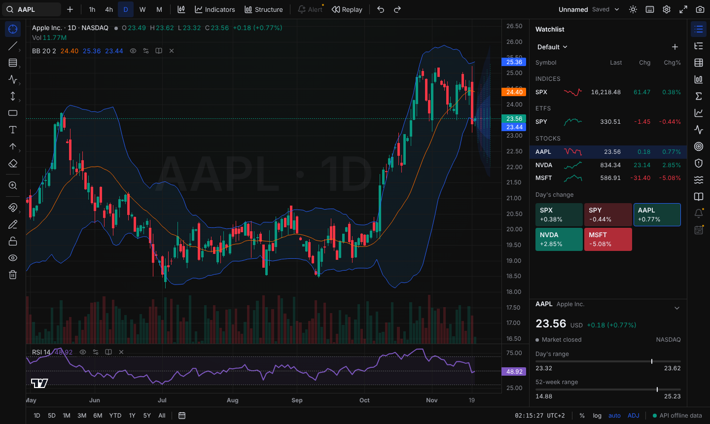

# ChartLab

A personal, local, TradingView-style charting, analysis and research platform: candles, indicators, drawing tools,
gap detection and bar replay — built so that education pages, custom indicators, backtesting and a **paper-only**
trading agent can plug in later.

> **Status (2026-11-26):** Phases 1–3 are complete and the Phase-1 review is done; **Phase 4 (backtesting) is
> planned** in [docs/PHASE4_PLAN.md](docs/PHASE4_PLAN.md).
> - **Charting:** candles and other chart types, 35 indicators (each verified like a DUT against scalar golden
>   models, TA-Lib and property tests incl. no lookahead), 20+ drawing tools (lines, Fib, channels, measuring and
>   statistics tools, the trade plan, patterns, icons), market structure, compare, layouts, undo/redo, bar replay.
> - **Learning:** a learn page for every indicator with live widgets, event studies and guided replay exercises.
> - **Research tools:** OHLC forecast with walk-forward validation and forecast-vs-actual, volatility cone, trade
>   plan probabilities, VaR/ES with backtests, market regime tests.
> - **Look:** six theme presets, accents, text size, chart backgrounds (static and animated).
>
> See [HANDOFF.md](HANDOFF.md) for the live status (Hebrew), [PLAN.md](PLAN.md) for the sequencing and
> [docs/ROADMAP.md](docs/ROADMAP.md) for the rounds.



The screenshot uses the synthetic end-to-end fixtures; real data comes from Yahoo (or Tiingo) on the user's machine.

## Features

| Feature | Status |
|---|---|
| Research, architecture, ADRs | ✅ Done |
| Scaffolding, CI, quality gates, dark app shell (R0) | ✅ Done |
| Market data: yfinance + Tiingo fallback, SQLite cache, validated daily/weekly/monthly bars, live watchlist prices (R1a) | ✅ Done |
| 1h and 4h intervals (session-aware, shown in the display time zone: Israel by default, configurable in chart settings), generated API types, fixture download script (R1b) | ✅ Done |
| Chart: candles + volume, OHLC legend on the crosshair, D/W/M intervals, symbol from the watchlist, pan/zoom (R2a) | ✅ Done |
| Chart types (bars/hollow/line/area/Heikin Ashi), log/% scale, range buttons, symbol search, lazy history (R2b) | ✅ Done |
| Indicator engine + SMA, EMA, WMA, SMMA: `/` dialog, legend values under the crosshair, live settings, saved between visits (R3a) | ✅ Done |
| Generalised MAs (DEMA, TEMA, HMA, ALMA, LSMA, VWMA, SWMA, McGinley, KAMA, T3, ZLEMA), generic MA, MA Cross with arrows, Ribbon, Envelope (R3b) | ✅ Done |
| Learn drawer for the MA family: derived formulas (KaTeX), lag, noise reduction, and a Filter view with the measured impulse, step and frequency response plus an MA-vs-MA compare (L1) | ✅ Done |
| Indicators: BB, VWAP, RSI (+ smoothing and BB), MACD, Stochastic, ATR, OBV, Volume SMA, oscillator panes with level lines, band fills, coloured MACD histogram — golden-tested (R3c) | ✅ Done |
| UX pass 1: UX profile, dimmed coming-soon buttons, key caps in tooltips, sliding pills, exit animations, price flashes, legend hover focus, undo toast, RSI/Stoch band shading, resizable panes, jump to latest, floating watchlist below 1100 px, `?` shortcuts (U1a) | ✅ Done |
| Wider side panels: the side panel and the learn panel widen by a drag on their left edge (or ←/→ on it; double click for the default), remembered between visits; display equations a size larger | ✅ Done |
| Appearance: Settings → Appearance with six theme presets (Dark, Light, Midnight, Graphite, Amber terminal, Paper), one accent (blue, purple, teal, amber), text size 100/110/125 %, chart backgrounds (solid, gradient, topographic lines, the symbol's ghost history, your own image dimmed and blurred), a Market pulse tint by the day's change, the symbol watermark, quiet volume and a watchlist heatmap of the day's change | ✅ Done |
| Chart tools (U3): compare up to three symbols as % lines (+ beside the symbol); patterns (XABCD and ABCD with their Fibonacci ratios, head and shoulders with its neckline); 14 icons; an eraser; a zoom-in box; Go to date in the bottom bar; a tooltip on forecast candles and a click on the fan for the Forecast tab; Ctrl+K for every side tab; animated chart backgrounds (drifting candles, ticker tape, aurora) | ✅ Done |
| UX pass 2: watchlist sparklines and symbol card, market status, `Ctrl+K` command palette, chart context menu, light/dark theme, chart snapshot (U1b) | ✅ Done |
| Drawing tools 1: trend line, ray, extended line, horizontal line/ray, vertical line, rectangle, text; select, move, resize, Shift 45°, weak/strong magnet, lock/hide all, Del with undo, floating toolbar, live settings panel, saved per symbol and shown on every interval (R4a) | ✅ Done |
| Drawing tools 2: Fib retracement and trend-based extension (editable level table, bands, ratio+price labels), parallel channel, price / date / date-and-price ranges (change, bars, time span, volume), trash menu to remove drawings, indicators or both with confirmation and undo, `Alt+F` (R4b) | ✅ Done |
| Market structure (R5): Structure menu; gap zones (open in colour, filled faded) with a Gaps panel (min size, partial gaps, click to scroll); previous day/week/month high, low, close as step lines; pivot points (5/5 fractals, drawn on the pivot bar); Data window with every value under the crosshair | ✅ Done |
| Workspace (R6): named layouts that autosave (chart, indicators, pane sizes, visible bars) with rename / copy / open / delete and `Ctrl+S`; several watchlists (create, rename, delete, sections, add through search, drag to reorder, right-click menu); one undo/redo history for the chart (`Ctrl+Z` / `Ctrl+Y`: symbol and interval, indicators, drawings); chart settings (time zone, candle colours, last-price line, volume); object tree; fullscreen; `Alt+R` reset view | ✅ Done |
| Bar replay (R7): start by a click, a day in a DD/MM/YYYY calendar (only days with bars), the last bar or at random; play/pause, `Shift+→` step, 0.5–10 bars/s; chart, legend, Data window, indicators and gaps end at the cursor; interval locked; no lookahead, tested for every registered indicator | ✅ Done |
| Learn platform (P2a): learn index (sidebar button, `Ctrl+K` → "Learn: …"); interactive widgets inside the pages on a random stock (six scenarios: random walk, uptrend, range, reversal, shock, volatility regime) or any symbol: move a parameter, an event study of a signal ("what followed it" vs an average bar, with the 95 % interval and the two distributions), combine up to three rules; a **Try it** tab with every parameter live; exercise cards that start the bar replay on a symbol and date; the MA family's pages rewritten with coloured equations, a "where" table for every variable, how to read it, why it works and what to combine it with | ✅ Done |
| Learn pages for the oscillators (P2b): RSI (Wilder's RMA as an IIR filter, why 70/30 from its distribution on a random walk), Stochastic (fast vs slow, pinned in a trend), MACD (a band-pass filter: its measured frequency response drawn inside the page), and "Combining indicators" (filter, trigger, confirmation; the mathematics of AND; redundant rules; multiple testing) | ✅ Done |
| Learn pages for bands, volatility and volume (P2c): Bollinger Bands, ATR, OBV, VWAP, Volume SMA, with hourly lab data in sessions and an accumulation scenario where volume leads price | ✅ Done |
| Structure, concepts and exercises (P2d): pivots, previous-period levels, gaps; concept pages (bars and sessions, adjusted prices, warm-up, lookahead and replay, lag and noise); a glossary whose terms show their definition on hover in every page; links between pages; guided Replay exercises with steps and a hidden answer | ✅ Done |
| Custom tools (P3): **Return** (two points: the change and the equivalent compound return per year, month, week, day or bar) and **Statistics** (a range: histograms of the returns and of their change with the normal curve, mean, standard deviation, annualised mean and volatility, in a Statistics side-panel tab) | ✅ Done |
| OHLC forecast (P3 F1–F2): the next k bars' open, high, low and close as probabilities (models A: OLS, C: ridge + HAR volatility), validated walk-forward against a naive benchmark and auto-tuned on past data; on the chart (Structure → Forecast: a fan of 50/80/95 % intervals and median candles), a Forecast tab with the validation and coefficients, frozen at the start of a replay ("Forecast from here") or made at any past bar (right-click → "Forecast from this bar"), compared with what happened (band-coloured dots on the actual closes; a Forecast vs actual section with the error, band and percentile per bar), calibration charts (coverage vs target, PIT histogram with a verdict), and a Forecasting OHLC learn page with a live widget | ✅ Done |
| Volatility (P3 V1): Historical Volatility from OHLC (Yang-Zhang, Garman-Klass, Rogers-Satchell, Parkinson, close-to-close; % a year from the bars counted per year) and Volatility Percentile on the chart; a Volatility tab with the cone per calendar horizon, the HAR forecast checked walk-forward, the squeeze probability against its base rate, the overnight and downside shares and the estimators' QLIKE scores (with the 1h realised variance); a learn page with a live widget | ✅ Done |
| Trade plan (P3 T1): a drawing tool for an entry, a target and a stop over a holding time; the Trade plan tab gives P(fill), P(target first), P(stop first) and P(neither) from the history's own paths at today's volatility (gaps, limit orders and the Brownian bridge for bars that touch both levels), the expected result in R, the loss when stopped, Kelly and the position size, an EV heat map of other distances, a calibration of past plans and what actually happened; a learn page | ✅ Done |
| Value at Risk (P3 R2): VaR Bands (FHS) on the chart with breach markers; a Risk tab with VaR and ES at 90/95/99 % for the next bar, a week and a month, for a long or a short, by four methods (normal, Cornish-Fisher, historical, extreme value), the 1-bar backtests (Kupiec, Christoffersen, Acerbi-Szekely) and the fitted tail; a learn page with a live widget | ✅ Done |
| Market regime (P3 G1): Variance Ratio (Chow-Denning, robust to volatility), Hurst Exponent (DFA) and a Market Regime tint behind the bars (trend / mean reversion at 5 %); a Regime tab with the wild-bootstrap p-value, Hurst against shuffles, the multifractal spectrum, the regime x volatility map and whether trend and reversion rules worked better in their regime; a learn page with a live widget | ✅ Done |
| Minute intervals (ADR 0017): 1m, 2m, 5m, 10m, 15m, 30m and 90m in a minutes menu that says how far back each goes; a note under the legend with the chart's actual history ("5m data since …"); minute charts update every minute; the local cache keeps every bar it downloaded, and a daily collector (`install-collector.ps1`) grows the minute history past Yahoo's 30/60 days | ✅ Done |
| Home vs Market, data (Phase H, H0; ADR 0018): Bank of Israel series (USD/ILS, CPI, the CBS dwelling index national and by district, the BoI rate, mortgage rates) behind `/api/macro`, cached and offline-testable; a Benchmarks group in the watchlist (S&P 500 and Nasdaq-100 total return, TA-125) and USD/ILS | ✅ Done |
| Planner, market account (Phase H, H1; ADR 0019): a Planner page for deposits (one-off and recurring) into any mix of Yahoo tickers, with or without USD/ILS; deposit, commission, management and monthly fees; dividends net of tax; capital-gains tax on the nominal, real or dollar gain; a row per deposit with its buy price, gross and net gain; XIRR nominal and real; six models of the buy price inside a bar, one estimated by Monte Carlo; an assumed inflation model; the data history of every ticker in one click | ✅ Done |
| Planner, apartment (Phase H, H2; ADR 0020): an Apartment tab for a purchase with a mortgage of up to three tracks (fixed, prime or variable; CPI-linked or not; Spitzer, equal principal, grace or balloon), the Bank of Israel rate from history or assumed with a shock, the value from the CBS dwelling index or an assumed growth, rent saved or received, purchase, owner and selling costs, purchase-tax and betterment-tax tables (the Tax Authority's 2026 amounts, editable and saved under a name); the payments of every track, the whole schedule, and the net worth if sold in any month | ✅ Done |
| Planner, comparison (Phase H, H3a; ADR 0021): a Compare tab for the apartment against the same money in the market (each option tops up to the other's spending, so both put in the same money on the same days), with or without the apartment's own market account; what each is worth at the end and its XIRR, breakeven rates (appreciation, market return, mortgage rates, rent), net worth averaged over the exit month; over history, a start on every month the data allows with P(apartment > market), the median difference, the effective number of independent windows, and a win map by start year and horizon | ✅ Done |
| Planner, simulation (Phase H, H3b; ADR 0022): the comparison over a thousand simulated worlds, by a block bootstrap of history (every series of a month together, the Bank of Israel rate's level with its block) or with a modelled market estimated from the mix; a histogram of the two options with two draggable handles and the share of worlds between them with its interval; percentiles and CVaR, the chance of ending below the money put in, regret, stochastic dominance, the certainty equivalent, and the risks on the way (negative equity, payment stress against an income, time under water, max drawdown, Sharpe and Sortino) | ✅ Done |
| Planner, what the answer depends on (Phase H, H3c; ADR 0023): the apartment's return shared between appreciation, rent, mortgage leverage and costs so that the shares add up; a tornado of each input moved both ways; who leads at every exit month and from when, with a chart that also shows a forced sale; liquidity; the correlation of dwelling prices with the market; and the same money split between the two options over the simulated worlds | ✅ Done |
| Planner, two options (Phase H, H4; ADR 0024): the Market and the Apartment tabs hold an option A and an option B (one set of forms until "Option B is the same as option A" is unticked), the Compare tab says what each contains, so an apartment can be set against another apartment or a mix against another mix; comparisons saved under a name by the backend; every results table as a CSV file; an apartment's own volatility on top of its index in a simulation | ✅ Done |
| Planner, learn pages and the rate stress test (Phase H, H5; ADR 0025): eight learn pages (XIRR and the three kinds of yearly rate, mortgage tracks, the apartment's ledger, the same money rule, overlapping windows, simulated worlds, risk metrics, what the answer depends on), each with its formulas, a table of every symbol, a worked example checked against the engine and a short derivation, opened from the section of the planner each explains; and the apartment's payments if the Bank of Israel rate rose by 1, 2 or 3 points | ✅ Done |
| Planner, withdrawals (Phase J, J0; ADR 0026): a Withdraw tab: a starting capital, a fixed net amount (indexed or not) or a percent of the account sold every month, on the Market tab's mix over history or on an assumed yearly return; when the money ends or what income it pays, the tax between its two bounds (the purchases behind the capital are not known), a chart of the balance and the income, a table by year and CSV | ✅ Done |
| Planner, withdrawals with an apartment (Phase J, J1; ADR 0027): an apartment already owned in the balance: its value (assumed growth or the dwelling index), lived in or rented out, its costs, what is left of its mortgage, kept, sold on a date or sold when the account runs out (and sold if the account cannot pay its costs), betterment tax on its own cost and purchase day; the net worth, what became of it at each tax bound, and the account with it in the chart | ✅ Done |
| Planner, withdrawals over many realizations (Phase J, J2; ADR 0028): Run history starts the plan on every month the mix's history allows, Simulate runs it on worlds (a block bootstrap of the mix, or a modelled market); how often it lasts, a histogram of what is left (a percent of the start or shekels), the share still paying or the income fan by year, the sustainable amount, the tax bounds, the evidence behind every share, and the plan's months in reverse order | ✅ Done |
| Planner, withdrawals from the Market plan's lots (Phase J, J4; ADR 0029): the account can be what the Market tab's plan accumulated, withdrawn from its last day with every deposit's own cost, first in first out, so the tax is exact and has no bounds; and the two options have Withdraw settings of their own, shown side by side | ✅ Done |
| Planner, withdrawals explained and kept (Phase J, J3; ADR 0030): three learn pages (what is left and for how long, the cost of what is sold, how much can be taken), both options' Withdraw settings in saved scenarios, and the tab's polish (learn links, folded sections, the study first, framed tables) | ✅ Done |
| Synthetic symbols (Phase K, K0; ADR 0031): a `SYN:` symbol of your own from the learn lab's scenarios (random walk, uptrend, range, reversal, shock, volatility regime, accumulation, regimes), with a seed, a first date and price, a length and a currency; 1h, 4h, daily, weekly and monthly bars (the hours aggregate to the scenario's daily bar), charted, compared, put in a watchlist or a Planner mix like any symbol; created and edited from the symbol search, the legend or the watchlist, with what points at it listed before an edit or a delete; marked "SYN" wherever it is listed and "Synthetic" on the chart | ✅ Done |
| Synthetic symbols: dwelling prices, a parametric symbol, a shuffled copy of a real one (Phase K, K1–K3) | 🗺️ Roadmap |
| More custom indicators (designed with the user), backtesting, paper agent (Phases 3–5) | 🗺️ Roadmap |

## Quick start

Prerequisites: [uv](https://docs.astral.sh/uv/) (installs Python 3.13 for you), Node.js 22+, Git.

### Windows (PowerShell)

```powershell
# one-time: allow local scripts
Set-ExecutionPolicy -Scope CurrentUser RemoteSigned
# install uv if needed
powershell -ExecutionPolicy ByPass -c "irm https://astral.sh/uv/install.ps1 | iex"

# reload PATH so this window sees uv (or open a new, non-admin PowerShell window)
$env:Path = "$env:USERPROFILE\.local\bin;$env:Path"

# clone into your user folder - never inside C:\Windows\System32 (no write access there)
cd $HOME
git clone https://github.com/tamirgabgab/trade-nig-view.git chartlab; cd chartlab
Copy-Item .env.example .env        # optional API keys
.\scripts\setup.ps1                # backend + frontend dependencies
.\scripts\dev.ps1                  # backend :8000 + frontend :5173
.\scripts\test.ps1                 # all tests, lint, typecheck
.\scripts\install-shortcut.ps1     # optional: "ChartLab" icon on the Desktop and in Start
```

After `install-shortcut.ps1`, double-click **ChartLab** on the Desktop: it downloads the latest version
(`git pull --ff-only`, libraries reinstalled only if they changed), starts the backend and the frontend and
opens the app in your browser. Offline or if the pull fails, it starts the version already on disk. Close the
black ChartLab window to stop it. To update without starting: `.\scripts\update.ps1`.

Maintenance scripts:

```powershell
.\scripts\make-fixtures.ps1        # download daily + 1h fixtures from Yahoo, test, commit and push them
.\scripts\install-collector.ps1    # once: collect 1m/5m/1h bars every weekday at 23:30 (Task Scheduler)
.\scripts\collect-intraday.ps1     # collect them now (log: data\collect-intraday.log)
.\scripts\gen-api.ps1              # after a backend API model change: regenerate openapi.json + schema.ts
```

> **Windows with Smart App Control on:** use the official, signed Python from python.org instead of uv's
> downloaded Python (SAC blocks its unsigned `.pyd` files):
> `winget install -e --id Python.Python.3.13`, then
> `[Environment]::SetEnvironmentVariable('UV_PYTHON_PREFERENCE','only-system','User')`, open a new PowerShell,
> delete `backend\.venv` and run `.\scripts\setup.ps1` again.

### macOS / Linux

```bash
curl -LsSf https://astral.sh/uv/install.sh | sh
git clone <repo-url> chartlab && cd chartlab
cp .env.example .env
./scripts/setup.sh
./scripts/dev.sh
./scripts/test.sh
```

Pip fallback (no uv): `cd backend; python -m venv .venv; .venv\Scripts\Activate.ps1; pip install -e . httpx2 pandas-stubs pyright pytest pytest-cov hypothesis ruff`
(add `ta-lib` for the TA-Lib reference tests).

Then open http://localhost:5173 (app) and http://127.0.0.1:8000/api/docs (API docs).

Offline mode: set `OFFLINE=1` in `.env` to serve committed fixture data only (no network). The real fixtures
(`backend/fixtures/`) are committed only once `.\scripts\make-fixtures.ps1` has run on a machine with internet
access; until then offline mode has no symbol data.

End-to-end tests (Playwright + Chromium; they start their own backend on synthetic data, ports 8010/5183):

```bash
cd frontend
npx playwright install chromium   # once
npm run e2e -- --trace off
```

On the chart: type any letter to search symbols; press `/` to add an indicator (gear icon on its legend row = live
settings); range buttons (1D … All) pick a fitting interval; scrolling to the left edge loads older history.

Indicator verification: `cd backend; uv run python -m pytest tests/golden` writes a scoreboard to
`backend/.reports/indicator_scoreboard.csv`. To cross-check against TradingView, type the values listed in
`backend/tests/golden/tv_crosscheck.json` (two or three dates per indicator; instructions inside) and run the tests.

## Project layout

```
backend/    FastAPI app, data providers + cache, indicators, analysis, storage, tests
frontend/   React + TypeScript + Vite app, ChartEngine wrapper, drawings, UI components
docs/       ROADMAP, ARCHITECTURE, TRADINGVIEW_RESEARCH, ADRs, indicator learn pages
scripts/    setup / dev / test / lint / update / gen-api scripts (PowerShell + bash), make-fixtures and
            install-shortcut (PowerShell)
```

## Documentation

- [Roadmap](docs/ROADMAP.md) · [Architecture](docs/ARCHITECTURE.md) · [TradingView research](docs/TRADINGVIEW_RESEARCH.md)
- [Architecture decision records](docs/adr/README.md)
- [CLAUDE.md](CLAUDE.md) — operating manual for AI-assisted development sessions

## Data sources and terms

ChartLab is a private, local research tool. Market data comes from:

- **Yahoo Finance via [yfinance](https://github.com/ranaroussi/yfinance)** (default, no key). Unofficial API; Yahoo's
  data is intended for personal use. Rate limits are undocumented — ChartLab throttles and caches aggressively.
- **[Tiingo](https://www.tiingo.com/)** (optional key, free tier) — fallback for stocks and ETFs.
- Optional key-based providers (later): Twelve Data (free tier is internal, non-display use only), Massive (formerly
  Polygon.io), Stooq.
- Committed CSV fixtures: today only small synthetic test fixtures (`backend/tests/fixtures/`); real snapshots for
  offline use (`backend/fixtures/`) are pending until `make-fixtures.ps1` runs.

Respect each provider's terms. Do not redistribute downloaded data.

## Disclaimer

ChartLab is for education and research only. **Nothing in this project is financial advice.** Indicator values,
backtests and any agent output may be wrong. The project contains no real-money trading functionality and never will
without a separately designed phase.

## Attribution

Charts are rendered with [TradingView Lightweight Charts™](https://github.com/tradingview/lightweight-charts)
(Apache License 2.0), Copyright © TradingView, Inc. The TradingView attribution logo on the chart is kept enabled.
ChartLab is not affiliated with TradingView; "TradingView" is a trademark of TradingView, Inc.
