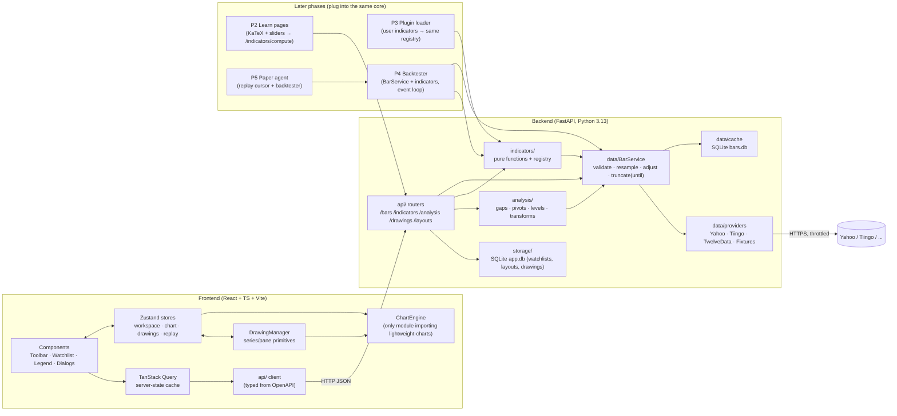
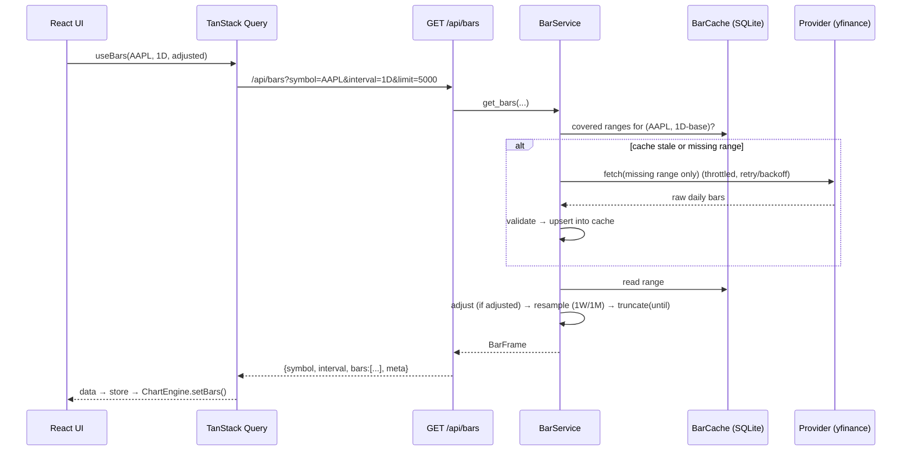

# ChartLab Architecture

> Status: design baseline from Stage A (2026-11-22). Changes require an ADR in [`docs/adr/`](adr/).

## 1. Goals that drive the design

1. **One indicator implementation** (Python) used by the chart, learn pages (P2), plugins (P3), the backtester (P4)
   and the paper agent (P5).
2. **No lookahead anywhere**: every computation can be truncated at a cursor `until`, and the result at bar `k` equals
   the result computed on `bars[:k+1]`.
3. **Correctness is testable**: every number on screen comes from a pure, tested function.
4. **The chart library is replaceable**: all `lightweight-charts` calls live behind `ChartEngine`.
5. **Works offline and in tests without network**: committed fixtures + `OFFLINE=1`.
6. **Windows-first developer experience**: PowerShell scripts, `uv`, no native build steps.

## 2. Components



### Backend modules (`backend/app/`)

| Module | Responsibility |
|---|---|
| `main.py` | App factory `create_app(settings)`, CORS, error handlers, router registration |
| `config.py` | `Settings` (pydantic-settings) from env / `.env` |
| `api/` | Thin routers: parse/validate, call services, map to response models. No business logic |
| `models/` | Pydantic v2 request/response models and domain dataclasses (`Bar`, `BarFrame`, `Interval`, `Symbol`) |
| `data/providers/` | `DataProvider` protocol + implementations (`yahoo.py`, `tiingo.py`, `fixtures.py`) |
| `data/cache/` | `BarCache` (SQLite), range bookkeeping, incremental fetch planning |
| `data/` (`bar_service.py`, `resample.py`, `validate.py`, `adjust.py`, `ratelimit.py`, `universe.py`) | Orchestration: cache → provider → validate; per request: truncate(`until`) → adjust → resample → window/limit |
| `indicators/` | One file per indicator (pure function) + `registry.py` + `core.py` (sma/ema/rma/stdev primitives) |
| `analysis/` | Gaps, pivots, prev-period levels, 52w high/low, Heikin Ashi transform |
| `replay/` | Cursor semantics helpers (`truncate_until`), later the event clock shared with the backtester |
| `storage/` | SQLite repositories for watchlists, layouts, drawings (`app.db`), schema migrations |

### Frontend modules (`frontend/src/`)

| Module | Responsibility |
|---|---|
| `api/` | Fetch client, generated TS types from the backend OpenAPI schema (`openapi-typescript`), query hooks |
| `chart/` | `ChartEngine` (create/destroy chart, panes, series, scale modes, crosshair events, time conversion), `theme.ts` |
| `indicators/` | Indicators dialog, legend rows, settings dialog generated from the registry `params` schema |
| `drawings/` | `DrawingManager`, tool definitions, geometry & hit-testing (pure TS, unit-tested), properties dialog |
| `components/` | Shell: `TopToolbar`, `DrawingToolbar`, `RightSidebar`, `Watchlist`, `BottomBar`, `SymbolSearch`, dialogs |
| `store/` | Zustand stores: `chartStore` (symbol, interval; chart type and scale in R2b; persisted to localStorage), later `indicators`, `drawings`, `replay`, `settings` |
| `styles/` | CSS custom properties (design tokens), global reset; component styles are CSS Modules |

## 3. Data flow

### 3.1 Loading a chart



### 3.2 Indicator compute

`POST /api/indicators/compute` → BarService loads bars for `[start - lookback(params), end]` ∩ `≤ until` →
registry function runs on the full loaded window → response is clipped to `[start, end]`.
The lookback guarantees that values inside the requested range are fully warmed-up and identical to a full-history
computation (verified by test). For recursive filters the seed influence after $k$ bars is $(1-\alpha)^k$: EMA
($\alpha=\frac{2}{n+1}$) gives $\approx e^{-2k/n}$, RMA ($\alpha=\frac1n$) gives $\approx e^{-k/n}$. Lookback = `max(25·n, 250)` bars
→ RMA residual $\approx e^{-25}\approx 1.4\times10^{-11}$, below the $10^{-9}$ test tolerance. When the data start is reached,
the true series start is used (identical to full history by construction).

### 3.3 Replay

The frontend holds a single `replay.cursor` (bar time). Every data request carries `until=cursor`; the backend truncates
**before** any computation. The frontend never filters future bars itself (it never receives them).

## 4. API contract (v1, JSON, prefix `/api`)

General: JSON only; snake_case fields; times as described in §6; errors as RFC 9457 `application/problem+json`;
OpenAPI at `/api/openapi.json`, docs at `/api/docs`. The same schema is committed as `frontend/src/api/openapi.json` and
turned into `frontend/src/api/schema.ts` (`scripts/gen-api.ps1`); tests fail when either file is stale (ADR 0008).

| Method & path | Query / body | Response | Round |
|---|---|---|---|
| `GET /health` | — | `{status:"ok", version, offline, providers:[{id, enabled}]}` | R0 |
| `GET /symbols` | `query?`, `group?` | `[{symbol, display, name, exchange, type: "index"\|"etf"\|"stock"\|"future"\|"forex", group, timezone, currency, has_volume, decimals, session_start}]` | R1 |
| `GET /bars` | `symbol`, `interval` (`1h`\|`4h`\|`1D`\|`1W`\|`1M`), `start?`, `end?`, `limit?` (default 5000, from the end), `adjusted=true`, `until?` | `{symbol, interval, adjusted, timezone, bars:[{time, open, high, low, close, volume}], has_more_before, source, stale, warnings}`; intraday `time` is UTC epoch seconds, daily+ `'YYYY-MM-DD'`; for intraday `start`/`end`/`until` select whole sessions | R1 (1h/4h R1b) |
| `GET /quotes` | `symbols=AAPL,NVDA,...` | `[{symbol, time, last, change, change_pct, stale, error}]` from the two latest unadjusted daily bars; per-symbol `error` instead of failing the request | R1a |
| `GET /indicators` | — | Registry metadata list (schema §5) | R3 |
| `POST /indicators/compute` | `{symbol, interval, id, params, start?, end?, until?, adjusted}` | `{id, params, outputs:{<name>:[{time, value}]}, markers?:[{time, kind, price?, text?}], warmup}` | R3 |
| `GET /analysis/gaps` | `symbol`, `interval`, `min_pct=0`, `include_partial=false`, `until?` | `[{start_time, direction, top, bottom, size_pct, filled, fill_time?, max_fill_pct}]` | R5 |
| `GET /analysis/pivots` | `symbol`, `interval`, `left=5`, `right=5`, `until?` | `[{time, kind:"high"\|"low", price, confirmed_time}]` | R5 |
| `GET /analysis/levels` | `symbol`, `interval`, `until?` | `{prev_day, prev_week, prev_month:{high, low, close}, high_52w, low_52w}` | R5 |
| `GET /drawings/{symbol}` / `PUT` | body = drawings document (§5.2) | document with `revision` | R4 |
| `GET /layouts` · `GET/PUT/DELETE /layouts/{name}` | layout document | | R6 |
| `GET /watchlists` · `GET/PUT/DELETE /watchlists/{name}` | `{name, sections:[{title, symbols:[...]}]}` | | R2 (read default) / R6 (edit) |

Concurrency for PUT documents: optimistic, `revision` integer; a stale `revision` → `409 Conflict`.

## 5. Schemas

### 5.1 Indicator registry entry

```python
@dataclass(frozen=True)
class ParamSpec:
    name: str                    # "length"
    type: Literal["int", "float", "bool", "enum", "source"]
    default: int | float | bool | str
    min: float | None = None
    max: float | None = None
    step: float | None = None
    options: tuple[str, ...] = ()  # for enum/source: ("close","open","high","low","hl2","hlc3","ohlc4")
    label: str = ""

@dataclass(frozen=True)
class OutputSpec:
    name: str                    # "upper"
    plot: Literal["line", "histogram", "area", "markers"]
    color: str                   # default color token, e.g. "#2962FF"
    line_width: int = 1
    # histogram may color by sign: positive/negative colors in `style`
    style: Mapping[str, str] = field(default_factory=dict)

@dataclass(frozen=True)
class IndicatorSpec:
    id: str                      # "bb" — stable, used in layouts & tests
    version: int                 # bump when output semantics change
    name: str                    # "Bollinger Bands"
    short_name: str              # "BB"
    category: Literal["moving_averages", "bands", "oscillators", "volatility", "volume", "structure"]
    overlay: bool                # True: price pane; False: own pane
    inputs: tuple[Literal["open","high","low","close","volume"], ...]
    params: tuple[ParamSpec, ...]
    outputs: tuple[OutputSpec, ...]
    levels: tuple[float, ...] = ()        # e.g. (70, 50, 30)
    fills: tuple[tuple[str, str], ...] = ()  # e.g. (("upper","lower"),)
    warmup: Callable[[Mapping[str, Any]], int]  # number of NaN bars at the start
    compute: Callable[..., Mapping[str, np.ndarray]]  # pure: (BarFrame, **params) -> {output: ndarray}
    learn_slug: str              # "bollinger-bands" -> docs/indicators/bollinger-bands.md
    intraday_only: bool = False  # VWAP
```

`GET /indicators` serialises everything except `warmup`/`compute`. The frontend builds the settings dialog purely from
`params` + `outputs` → adding an indicator needs no frontend change.

### 5.2 Drawings document (schema version 1)

```jsonc
{
  "schema_version": 1,
  "symbol": "AAPL",
  "revision": 7,
  "drawings": [
    {
      "id": "01JD3...",                 // ULID, client-generated
      "type": "fib_retracement",        // tool id from the frontend tool registry
      "points": [                        // anchors in data space, never pixels
        { "time": 1730073600, "price": 226.15 },   // UTC epoch seconds of the anchor bar's open
        { "time": 1732579200, "price": 237.81 }
      ],
      "style": { "line_color": "#787B86", "line_width": 1, "line_style": "solid" },
      "props": {                         // tool-specific, validated per type
        "levels": [ { "value": 0.618, "visible": true, "color": "#089981" } ],
        "show_prices": true, "extend_right": false
      },
      "locked": false, "hidden": false, "z": 3,
      "created_at": "2026-11-22T19:00:00Z", "updated_at": "2026-11-22T19:05:00Z"
    }
  ]
}
```

Rules: anchors store the **UTC epoch second of the bar open**; when rendered on another interval the anchor maps to the
bar containing that instant (logical index), with fractional interpolation inside the bar and linear extrapolation beyond
the last bar using the bar spacing. Each tool type has a JSON-schema (pydantic model on the backend) for `props`.
Migrations: `schema_version` bump + a pure migration function `v1 → v2`, tested.

### 5.3 Layout document

`{schema_version, name, symbol, interval, chart_type, scale_mode, adjusted, indicators:[{instance_id, id, version,
params, style, pane, visible}], pane_stretch:[...], visible_range?, drawings_ref: symbol}`.

## 6. Time conventions

- **Storage**: bars stored with `ts` = UTC epoch seconds of the bar open; daily bars use the session date at 00:00 UTC
  as the key (`date` column) plus the symbol's exchange timezone (`America/New_York` for US) in the symbol metadata.
- **API → chart**: daily and above → business-day string `"YYYY-MM-DD"` (session date; week bars keyed by the first
  trading day of the week, month bars by the first trading day of the month). Intraday → UTC epoch seconds.
- **Sessions (R1b)**: every intraday bar belongs to a trading session identified by its session date, the same date as
  that session's daily bar: `date(wall + 24h - session_start)` when the symbol has `session_start` (CME futures
  `18:00`, ICE DXY `20:00`, forex `17:00`, all New York time), else the exchange-local calendar date
  (`app/data/sessions.py`). 4h bars are anchored to the session's first bar (US stocks 09:30/13:30; futures
  18/22/02/06/10/14). Intraday dividend adjustment uses the factor of the session's daily bar.
- **Display**: Lightweight Charts has no time-zone support. `ChartEngine` converts intraday UTC timestamps to
  "wall-clock seconds" in the display TZ (`utc + offset(tz, utc)`, `chart/timeZone.ts`) before `setData`. The display
  TZ is `Asia/Jerusalem` (a setting arrives in R6); offsets come from `Intl.DateTimeFormat`, cached per UTC day and
  computed per bar on DST days, so the shift is exact. The crosshair reports a bar index, never a shifted time, so no
  reverse conversion is needed. Only the chart layer knows about this shift; the bottom-bar clock shows the same zone.
- `until` / `start` / `end` query params are ISO dates (`2026-11-20`), interpreted as **inclusive**. For intraday
  intervals they are session dates and select whole sessions.

## 7. Indicator verification harness

Treat every indicator like a DUT:

| Layer | What | Where | Tolerance |
|---|---|---|---|
| Directed tests | Hand-computed vectors (5–30 bars), edge cases: constant series, `n=1`, `n > len`, NaN in input, zero volume, flat high=low | `tests/unit/indicators/test_<id>.py` | exact or `1e-12` |
| Golden model | Independent scalar loop implementation of the Pine semantics (`tests/golden/models.py`), compared on all fixture symbols, **every bar** including warm-up NaN positions | `tests/golden/test_golden_<id>.py` | `rtol=1e-9, atol=1e-12` |
| Second reference | TA-Lib on the converged region (per-indicator documented offset) | `tests/golden/test_talib_<id>.py` | `rtol=1e-9` (looser only with a written reason) |
| Properties | hypothesis-generated OHLCV (valid by construction): bounds, monotonicity, constant-input, scale/shift equivariance (SMA(a·x+b)=a·SMA(x)+b), **prefix invariance (no lookahead)** | `tests/property/` | `1e-9` relative |
| Scoreboard | Golden runs write a CSV report (max abs/rel error per indicator×symbol) to `backend/.reports/` | CI artifact | — |
| Manual cross-check | 3 AAPL 1D dates per indicator vs TradingView values typed by the user | `tests/golden/tv_crosscheck.json` | display precision (2 decimals) |

A shared `check_no_lookahead(spec, bars, k)` helper asserts `compute(bars)[k] == compute(bars[:k+1])[k]` for random `k` —
used by R3 property tests and the R7 replay DoD.

## 8. Caching & rate-limit policy

- **Bar cache** (`data/bars.db`, SQLite, WAL): table `bars(symbol, interval_base, date_or_ts, open, high, low, close,
  adj_close, volume, dividend, split, source, fetched_at)`, PK `(symbol, interval_base, date_or_ts)`; table
  `coverage(symbol, interval_base, start, end, fetched_at)`. Only base intervals are stored (`1D`, `1h`); `1W`/`1M` are
  resampled on read (cheap, always consistent).
- **Incremental fetch**: compute missing ranges against `coverage`; fetch only those. Daily data refreshed if the last
  bar is older than the last completed session; the last 5 bars are always re-fetched on refresh (late corrections,
  dividends). Full re-fetch if a new split/dividend changes the adjustment factor history (detected via `adj_close/close`
  ratio change on overlapping bars).
- **Throttling**: per-provider token bucket (Yahoo: conservative 1 req/s, burst 3; Tiingo: 50/h; Twelve Data: 8/min) +
  exponential backoff with jitter on 429/5xx (base 2 s, max 60 s, 4 tries) + a circuit breaker (provider disabled for
  10 min after repeated 429s; next provider in `DATA_PROVIDERS` is tried).
- **Stale-while-error**: if every provider fails, serve cached data with `meta.stale=true` and a warning header.
- **Frontend**: TanStack Query `staleTime` 60 s for bars/quotes, `Infinity` for registry metadata.
- **Offline**: `OFFLINE=1` → only the `fixtures` provider (CSV snapshots in `backend/fixtures/daily/`) is registered.
- **Symbol universe**: `backend/config/universe.toml` (order = watchlist order; `group` = section).

## 9. Error handling

- Backend raises typed domain errors (`SymbolNotFound`, `IntervalNotSupported`, `ProviderRateLimited`,
  `ProviderUnavailable`, `DataValidationError`, `RevisionConflict`); one exception handler maps them to problem+json
  (`type`, `title`, `status`, `detail`, `instance`, plus `code`). Unexpected errors → 500 with a correlation id logged.
- Validation errors from pydantic → 422 problem+json.
- Data validation (R1): duplicates, `high < max(open, close)`, `low > min(open, close)`, negative volume, non-monotonic
  time → bar rejected and logged; date gaps beyond the exchange calendar reported in `meta.warnings`.
- Frontend: every query has loading / empty / error states; errors shown as non-blocking toasts with a retry action.

## 10. Security & safety

- Single-user local app, binds to `127.0.0.1` by default. No auth in Phase 1.
- API keys only via `.env` (never committed, never sent to the frontend, never logged).
- No broker integration, no order routing, no real money — the P5 agent is paper-only by construction (no broker
  adapter interface exists).

## 11. Extensibility hooks for Phases 2–5

| Phase | Hook already present in Phase 1 |
|---|---|
| P2 Learn pages | `IndicatorSpec.learn_slug`, `docs/indicators/<slug>.md` stubs, compute endpoint with arbitrary params |
| P3 Custom indicators | Registry accepts entries from a plugin loader; same `IndicatorSpec` + same golden harness |
| P4 Backtester | `BarService.get_bars(until=...)`, pure indicator functions over numpy arrays, `markers` output type, prefix-invariance tests |
| P5 Paper agent | Replay cursor semantics shared with the backtester clock; no broker interface by design |
