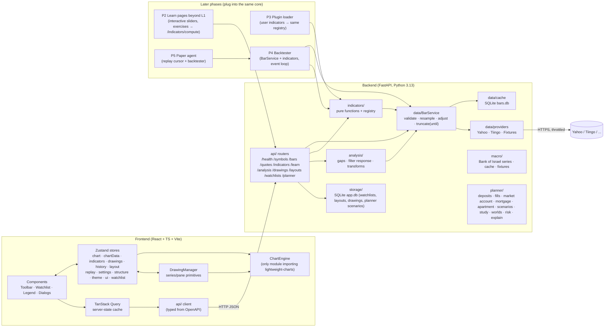

# ChartLab Architecture

> Status: reflects the code at the end of Phase 1 (R0–R7, 2026-11-23). Changes require an ADR in [`docs/adr/`](adr/).

## 1. Goals that drive the design

1. **One indicator implementation** (Python) used by the chart, learn pages (P2), plugins (P3), the backtester (P4)
   and the paper agent (P5).
2. **No lookahead anywhere**: every computation can be truncated at a cursor `until`, and the result at bar `k` equals
   the result computed on `bars[:k+1]`.
3. **Correctness is testable**: every number on screen comes from a pure, tested function.
4. **The chart library is replaceable**: all `lightweight-charts` calls live behind `ChartEngine`.
5. **Works offline and in tests without network**: committed fixtures + `OFFLINE=1`.
6. **Windows-first developer experience**: PowerShell scripts, `uv`, no native build steps.

## 2. Components



### Backend modules (`backend/app/`)

| Module | Responsibility |
|---|---|
| `main.py` | App factory `create_app(settings)`, CORS, error handlers, router registration |
| `config.py` | `Settings` (pydantic-settings) from env / `.env` |
| `api/` | Thin routers: parse/validate, call services, map to response models. No business logic |
| `models/` | `BarFrame` (column arrays) and `Interval` (`bars.py`), `SymbolInfo` (`symbols.py`), pydantic documents for drawings, layouts and watchlists |
| `data/providers/` | `DataProvider` protocol + implementations (`yahoo.py`, `tiingo.py`, `fixtures.py`, and `synthetic.py`, which `BarService` asks directly for `SYN:` symbols, uncached, ADR 0031) |
| `data/synthetic.py`, `data/synthetic_returns.py`, `data/synthetic_shuffle.py`, `models/synthetic.py`, `storage/synthetic.py`, `api/synthetic.py` | Synthetic symbols (ADR 0031 to 0034): definitions in `app.db` (a union by `kind`: a lab scenario, a dwelling price index, a parametric symbol's statistics, or a shuffled copy of a market symbol), attached to the `Universe` (`with_extra`) so every `resolve` sees them; hourly bars aggregating to each kind's daily bars; a dwelling symbol reads its index from `MacroService`; `synthetic_returns.py` draws a parametric symbol's daily returns (five families, AR(1), GARCH(1,1), compensated jumps, exact mode) and its preview; `synthetic_shuffle.py` permutes a market symbol's blocks of daily bars (its source read through `BarService`) and measures both paths' sequences |
| `data/cache/` | `BarCache` (SQLite), coverage bookkeeping (what was requested, when, from which provider) |
| `data/` (`bar_service.py`, `resample.py`, `sessions.py`, `validate.py`, `adjust.py`, `ratelimit.py`, `universe.py`) | Orchestration: cache → provider → validate; per request: truncate(`until`) → adjust → resample (session-anchored for intraday, `sessions.py`) → transform → window(`before`, `limit`) |
| `indicators/` | One file per indicator (pure function) + `registry.py` (spec dataclasses, param validation) + `catalog.py` (the 35 registered specs) + `ma.py` (`MA_TYPES` dispatcher) + `core.py` (sources, filters and rolling primitives) |
| `analysis/` | Filter response (`response.py`, L1), Heikin Ashi (`transforms.py`), gaps (`gaps.py`, R5); the learn lab: synthetic scenarios (`synthetic.py`), rule conditions (`conditions.py`) and event studies (`events.py`); the Phase-3 engines: OHLC forecast (`forecast.py`, ADR 0010), volatility (`volatility.py`, ADR 0011), trade plan (`trade_plan.py`, ADR 0012), VaR/ES (`risk.py`, ADR 0013), market regime (`regime.py`, ADR 0014). Pivots and previous-period levels are registry indicators (`indicators/pivots.py`, `prev_hlc.py`); an indicator's `display_shift` draws its outputs left of their (causal) bar |
| `storage/` | SQLite repositories for watchlists, layouts, drawings (`app.db`), schema migrations |

### Frontend modules (`frontend/src/`)

| Module | Responsibility |
|---|---|
| `api/` | Fetch client, generated TS types from the backend OpenAPI schema (`openapi-typescript`), query hooks |
| `chart/` | `ChartEngine` (create/destroy chart, panes, series, scale modes, crosshair and pointer events, time conversion, compare lines, watermark, zoom box), `theme.ts` (canvas colours from the CSS tokens); primitives and helpers: `drawingLayer`, `gapLayer`, `replayLayer`, `forecastLayer`, `backgroundLayer`, `bandFill`, `timeZone`, `visibleRange`, `seriesData`, `chartTypes`, `rafLatest`. The canvas is transparent over a DOM `ChartBackdrop` (ADR 0015) |
| (indicators) | No folder of its own: `components/IndicatorsDialog`, `IndicatorLegend`, `IndicatorSettingsPanel` (generated from the registry `params` schema), `useChartIndicators`, `indicatorActions`; `api/indicators.ts`; `store/indicatorStore.ts` |
| `drawings/` | Pure TS, unit-tested: `anchors`, `fib`, `geometry`, `manager` (`DrawingManager`: tools, eraser, zoom box), `measure`, `returnStats`, `patterns` (XABCD/ABCD ratios), `iconPaths` (Lucide paths), `render`, `shapes` (hit-testing), `snap`, `types`. Tool definitions live in `components/drawingTools.ts`; properties UI = `DrawingFloatToolbar`, `DrawingSettingsPanel`, `FibLevelsTable` |
| `components/` | Shell: `TopToolbar`, `DrawingToolbar`, `RightSidebar` (Watchlist, Object tree, Data window, Gaps, Statistics, Forecast, Volatility, Trade plan, Risk, Regime tabs), `BottomBar`, `SymbolSearchDialog` (also Compare and watchlist add), `CommandPalette`, `ReplayBar` + `DatePicker`, `LayoutMenu`, `SettingsDialog` (Chart and Appearance), `ChartBackdrop` + `AnimatedBackdrop`, other dialogs; `LearnDrawer` (lazy-loaded: `LearnPage` renders Markdown + KaTeX; `lab/` holds the live widgets: filter view, event studies, the forecast, volatility, risk and regime labs) |
| `store/` | Zustand stores: `chartStore` (symbol, interval, chart type, scale, compare; persisted to localStorage), `chartDataStore` (what the chart shows, published for the side panels), `indicatorStore`, `drawingStore`, `historyStore` (undo/redo), `layoutStore` + `layoutSync`, `replayStore`, `settingsStore` (chart and appearance settings), `structureStore` (gaps, forecast), `forecastOriginStore`, `volatilityStore`, `themeStore` (presets), `panelWidthStore`, `backdropImageStore`, `uiStore`, `watchlistStore` |
| `styles/` | CSS custom properties (design tokens), global reset; component styles are CSS Modules |

## 3. Data flow

### 3.1 Loading a chart

```mermaid
sequenceDiagram
  participant UI as React UI
  participant Q as TanStack Query
  participant B as GET /api/bars
  participant S as BarService
  participant C as BarCache (SQLite)
  participant P as Provider (yfinance)
  UI->>Q: useBarHistory(AAPL, 1D, adjusted, transform)
  Q->>B: /api/bars?symbol=AAPL&interval=1D&limit=5000
  B->>S: get_bars(...)
  S->>C: coverage of (AAPL, 1D base)?
  alt no coverage (first request)
    S->>P: fetch full history   (throttled, retry/backoff)
  else coverage older than refresh_ttl_s (900 s)
    S->>P: fetch last 10 days (1D) / 5 days (1h)
    Note over S: overlap disagrees with the cache → full re-download
  end
  P-->>S: raw bars
  S->>S: validate → store into cache
  S->>C: read history
  S->>S: truncate(until) → adjust (if adjusted) → resample (1W/1M; 4h session-anchored) → transform (Heikin Ashi) → window(before, limit)
  S-->>B: BarsResult
  B-->>Q: {symbol, interval, adjusted, transform, timezone, bars:[...], has_more_before, source, stale, warnings}
  Q-->>UI: bars → ChartEngine.setBars()
```

The bars are not kept in a store: `ChartArea` passes them through `ChartView` to `ChartEngine` and publishes what the chart shows
(`store/chartDataStore.ts`) only for the side panels (Data Window, Gaps).

**Lazy history (R2b).** The first page is the newest `limit` bars. When the visible range comes within 50 bars of the
oldest loaded bar, the frontend asks for the next page with `before=<epoch seconds of the oldest bar>` (a daily bar
counts as 00:00 UTC of its date) and prepends it; `ChartEngine.setBars` shifts the logical range by the number of
prepended bars, so the same candles stay under the mouse. Pages are TanStack `useInfiniteQuery` pages keyed by
`(symbol, interval, adjusted, transform)`. Transforms (Heikin Ashi) run on the full history **before** windowing, so a
page equals the same slice of the full-history result (tested).

**Range buttons.** Each button switches to an interval that fits the span (1D → 1m, 5D → 5m, 1M → 30m, 3M → 1h, 6M → 4h, YTD/1Y → 1D,
5Y → 1W, All → 1M), loads older pages until the span's start is covered (or history ends), then sets the visible
range once (`chart/visibleRange.ts`, pure and unit-tested).

### 3.2 Indicator compute

`POST /api/indicators/compute` → BarService loads bars for `[start - lookback(params), end]` ∩ `≤ until` →
registry function runs on the full loaded window → response is clipped to `[start, end]`.
The lookback guarantees that values inside the requested range are fully warmed-up and identical to a full-history
computation (verified by test). For recursive filters the seed influence after $k$ bars is $(1-\alpha)^k$: EMA
($\alpha=\frac{2}{n+1}$) gives $\approx e^{-2k/n}$, RMA ($\alpha=\frac1n$) gives $\approx e^{-k/n}$. Lookback = `max(25·n, 250)` bars
→ RMA residual $\approx e^{-24}\approx 3.8\times10^{-11}$ (the RMA seed sits at bar $n-1$ of the loaded history; see `registry.py`), below the $10^{-9}$ test tolerance. When the data start is reached,
the true series start is used (identical to full history by construction).

The lookback is **per spec** (`IndicatorSpec.lookback(params)`, R3b); the default is `max(25·n, 250)` with n = the
longest `*length*` parameter. Filters whose seed fades more slowly define their own:

| Indicator / MA type | Lookback | Why |
|---|---|---|
| T3 | `max(50·n, 250)` | six cascaded EMAs |
| KAMA | `max(25·n, 25·((S+1)/2)² + n, 250)`, S = `slow` (`fast > slow` is rejected) | the slowest smoothing is $s^2$, seed fades like $(1-s^2)^k$ (≈ 6,000 bars for S = 30) |
| Composites (MA Cross, Ribbon, Envelope, generic MA, Bollinger basis, ATR) | max over their averages' lookbacks | |
| MACD, RSI with smoothing (R3c) | lookback of the first stage + lookback of the average applied to it | the second average is seeded on the first stage's not-yet-converged values |
| OBV (R3c) | `10**9` (whole history) | a running sum from the first bar: any later start shifts every value |
| Previous Period High/Low/Close (`prev_hlc`) | `10**9` (whole history) | the values depend on where the first period of the loaded data starts |

On top of that, `IndicatorSpec.total_lookback` adds the spec's plot shift (`IndicatorSpec.shift`, the `offset`
param of MAs that call `core.shift`; LSMA's regression `offset` is not a shift): a shift of k bars shows the value of bar
t − k at bar t, so k more bars are needed. The API reports and uses `total_lookback`. A test computes every registered
indicator over a window with large offsets and compares it with the full history.

**Lookback contract with lazy history (E5, defined in R2b, consumed in R3a).** The chart asks for indicator values over
exactly the bars it has loaded: `start = time of the oldest loaded bar`, `end = time of the newest`. The backend, not
the frontend, adds the warm-up: it loads `lookback` extra bars before `start` (per spec, see above; at least
`max(25·n, 250)` with n = the longest length parameter, plus the plot offset). When older history is prepended, the frontend recomputes the indicator for the new
`[start, end]` and replaces its series (no client-side stitching of two computations). Values for bars that were
already shown therefore do not change, except within floating-point tolerance, which the R3a harness asserts.

### 3.3 Replay

The frontend holds a single `replay.cursor` (bar time, `store/replayStore.ts`). During a replay it keeps the bars it has
already loaded, shows `bars[0..cursor]` and cuts the indicator and gap results (computed over all loaded bars) at the
cursor; no request carries `until` per step. This is exact because every indicator is free of lookahead
(`tests/golden/test_replay_no_lookahead.py`; details in §5.4). The backend `until` parameter, which truncates
**before** any computation, remains for API clients and the backtester (P4).

## 4. API contract (v1, JSON, prefix `/api`)

General: JSON only; snake_case fields; times as described in §6; errors as RFC 9457 `application/problem+json`;
OpenAPI at `/api/openapi.json`, docs at `/api/docs`. The same schema is committed as `frontend/src/api/openapi.json` and
turned into `frontend/src/api/schema.ts` (`scripts/gen-api.ps1`); tests fail when either file is stale (ADR 0008).

| Method & path | Query / body | Response | Round |
|---|---|---|---|
| `GET /health` | — | `{status:"ok", version, offline, providers:[{id, enabled}]}` | R0 |
| `GET /symbols` | `query?`, `group?` | `[{symbol, display, name, exchange, type: "index"\|"etf"\|"stock"\|"future"\|"forex"\|"synthetic", group, timezone, currency, has_volume, decimals, session_start}]` | R1 |
| `GET /bars` | `symbol`, `interval` (`1m`\|`2m`\|`5m`\|`15m`\|`30m`\|`90m`\|`1h`\|`4h`\|`1D`\|`1W`\|`1M`), `start?`, `end?`, `limit?` (default 5000, from the end), `before?` (epoch seconds, exclusive: only bars starting earlier; paging cursor), `adjusted=true`, `transform=none`\|`heikin_ashi`, `until?` | `{symbol, interval, adjusted, transform, timezone, bars:[{time, open, high, low, close, volume}], has_more_before, source, stale, warnings, history_start, provider_window_days}` (`history_start`: UTC seconds of the oldest bar that exists; `provider_window_days`: intraday only, the days the provider keeps); intraday `time` is UTC epoch seconds, daily+ `'YYYY-MM-DD'`; for intraday `start`/`end`/`until` select whole sessions | R1 (1h/4h R1b, `before`/`transform` R2b, minutes and depth 2026-11-26) |
| `GET /quotes` | `symbols=AAPL,NVDA,...` | `[{symbol, time, last, change, change_pct, stale, error, spark, day_low, day_high, low_52w, high_52w}]` from the unadjusted daily bars (`spark` = last 20 closes; 52-week range = 365 days up to the last bar); per-symbol `error` instead of failing the request | R1a, U1b |
| `GET /indicators` | — | Registry metadata list (schema §5) | R3 |
| `POST /indicators/compute` | `{symbol, interval, id, params, start?, end?, until?, adjusted, transform}` (`start`/`end` = epoch seconds of bar starts, inclusive) | `{id, version, params (resolved), time:[t], outputs:{<name>:[value\|null]}, warmup, lookback, display_shift}` — column arrays aligned with `time`; `null` = warm-up/NaN. A `markers` output holds `+1` (up) / `-1` (down) / `null` for MA Cross, the pivot price / `null` for Pivots. `display_shift` = bars the chart draws the outputs to the left of their bar (Pivots: `right`). `warmup` = first valid bar of the output that starts **last** (a composite's faster outputs start earlier); `lookback` = `total_lookback` (incl. offset). Cross-parameter errors (e.g. KAMA `fast > slow`, HMA length 1) are 422 `invalid_params` | R3 |
| `POST /indicators/response` | `{id, params}` | Filter view: `{id, version, params, outputs:[{name, label, linear, reason, step, ramp_lag (null for band-pass), impulse, dc_gain, lag, nrf, frequency:{period, magnitude_db, group_delay}, truncated}]}` measured by running the indicator on synthetic bars (`app/analysis/response.py`). Linearity is tested (superposition + volume independence); a non-linear output gets `step`/`ramp_lag` and a `reason`, its other fields `null`. Listed: outputs that follow the price (a fixed non-zero multiple of it on flat bars), and linear **band-pass** outputs (0 on flat bars: MACD, its signal and histogram, P2b), which have `lag` and `ramp_lag` null and a DC gain of 0 up to rounding; non-linear oscillators and volume lines (RSI, Stochastic, OBV, ...) return an empty list (R3c). POST (not the PLAN's GET) because `params` is a free-form object, as in `/indicators/compute` | L1 |
| `GET /learn/{slug}` | — | `{slug, markdown}` from `docs/indicators/<slug>.md`; only slugs a registered indicator names, and the concept pages (`combinations`), are served (404 `learn_page_not_found` otherwise) | L1 |
| `POST /learn/forecast` | `{source` (as `/learn/lab`)`, k, model}` | the auto-tuned `/forecast` response for a synthetic scenario or a symbol's last bars (the learn page's widget) | P3 F2 |
| `POST /learn/volatility` | `{source` (as `/learn/lab`)`, estimator}` | the `/volatility` response (month squeeze, rank 10, 1.5×) for a synthetic scenario or a symbol's last bars (the learn page's widget) | P3 V1 |
| `POST /learn/risk` | `{source` (as `/learn/lab`)`}` | the `/risk` response for a synthetic scenario or a symbol's last bars (the learn page's widget) | P3 R2 |
| `POST /learn/regime` | `{source` (as `/learn/lab`)`}` | the `/regime` response for a synthetic scenario or a symbol's last bars (the learn page's widget) | P3 G1 |
| `GET /learn` | — | `{pages:[{slug, title, kind:"indicator"\|"concept", category, indicator_id}]}`: every learn page that exists (the index, the palette); concept pages: combinations, gaps, bars-and-sessions, adjusted-prices, warm-up, lookahead-and-replay, lag-and-noise, guided-exercises, glossary | P2a, P2d |
| `POST /learn/lab` | `{source, indicators:[{id, params}] (≤ 4), conditions:[{left, op, right}] (≤ 3, AND), horizon}`; `source` = `{kind:"synthetic", scenario, seed, bars, interval}` (`random_walk`\|`uptrend`\|`range`\|`reversal`\|`shock`\|`volatility_regime`\|`accumulation`, 100–2000 bars, `interval` `1D`\|`1h`: seven hourly bars per session with sessions set, `app/analysis/synthetic.py`) or `{kind:"symbol", symbol, bars, interval}` (the last `bars` adjusted bars); an operand is `{indicator: <index>, output, ago?}`, `{price, ago?}` or `{value}` (`ago` = the series that many bars earlier); `op` `lt`\|`gt`\|`crosses_above`\|`crosses_below`; `horizon` 1–60 bars | `{time` (`'YYYY-MM-DD'`, or UTC epoch seconds on `1h`)`, open, high, low, close, volume, indicators:[{id, params, outputs, display_shift}], study}`; `study` (null without conditions) = event study of the forward `horizon`-bar log return after each episode vs every bar: `{horizon, events, baseline` (`{n, mean, median, std, hit_rate}`), `edge, se, t_stat, ci95, histogram:{edges, events, baseline}, event_index}`; at most one event per `horizon + 1` bars (a signal within `horizon` bars of a counted one is skipped). 422 `invalid_lab_request` for a bad index/output | P2a |
| `GET /analysis/gaps` | `symbol`, `interval=1D`, `min_pct=1` (0–50), `partial=false`, `adjusted=true`, `until?` | `{symbol, interval, gaps:[{time, filled_time\|null, direction, kind:"full"\|"partial", top, bottom, size_pct, fill_price\|null}]}` over the interval's whole history, by time; times in the bars' format | R5 |
| `GET /forecast` | `symbol`, `interval=1D`, `k=5` (1–20), `model=c`\|`a`, `auto=true`; manual: `window` (0 = all, else ≥ 60), `ridge`, `lags` (1–10); `adjusted=true`, `until?`, `origin?` (bar open, epoch seconds: forecast from that bar, the replay origin) | `{symbol, interval, model, auto, params:{window, ridge, lags}, last_time, last_close, levels, horizons:[{h, open, high, low, close (price quantiles at levels), close_percentiles (1..99 %), p_up, expected_range}], validation:[{model:"naive"\|"a"\|"c", h, n, pinball, coverage:[50, 80, 95 %], r2, hit_rate, pit (10 equal bins)}], coefficients:[{feature, value}], tuning:[{params, pinball}]}`; ADR 0010; 422 `not_enough_history` | P3 F1 |
| `GET /volatility` | `symbol`, `interval=1D`, `estimator=yang_zhang`\|`close`\|`parkinson`\|`garman_klass`\|`rogers_satchell`, `horizon=month`\|`week`\|`quarter` (of the squeeze, shares and scores), `threshold=10` (1–50), `factor=1.5` (1.05–5), `adjusted=true`, `until?`, `origin?` | `{symbol, interval, estimator, last_time, bars_per_year, levels, horizons:[{label, bars, current, ci, percentiles, rank, forecast:{low, median, high, coverage, qlike, qlike_naive}\|null}], main, squeeze:{horizon, bars, threshold, factor, rank, active, events, independent, p, ci, base_rate, move_events, move_all}\|null, overnight:{window, history}, downside:{window, history}, scores:[{estimator, label, n, qlike, bias}], realized}` (per-bar volatilities); ADR 0011; 422 `not_enough_history` | P3 V1 |
| `GET /trade-plan` | `symbol`, `interval=1D`, `adjusted=true`, `time` (the entry anchor, epoch seconds), `entry`, `target`, `stop` (> 0; the entry between them; long when the target is above), `h` (1–250 bars), `cursor?` (replay: no bar after this open, epoch seconds) | `{symbol, interval, side, h, origin_time, origin_close, sigma, summary:{paths, p_fill, p_target, p_stop, p_neither, p_target_bounds, bars, ev_r, ev_return, loss_r, kelly}\|null, multiples, heat (EV in R, rows = stop, columns = target distance in σ√h), reference, calibration:{n, forecast, observed, count, brier, brier_base}\|null, actual, actual_r}`; ADR 0012; 422 `invalid_plan`, `not_enough_history` | P3 T1 |
| `GET /risk` | `symbol`, `interval=1D`, `adjusted=true`, `origin?` (replay: at this bar) | `{symbol, interval, last_time, last_close, sigma, estimates:[{horizon:"bar"\|"week"\|"month", bars, method:"normal"\|"cornish_fisher"\|"fhs"\|"evt", level (0.9/0.95/0.99), tail:"long"\|"short", var, es (fractions of the price)}], tails:[{tail, threshold, xi, beta, exceedances}], backtests:[{method, level, tail, n, breaches, expected, kupiec, christoffersen, z2, z2_p}]}`; ADR 0013; 422 `not_enough_history` | P3 R2 |
| `GET /regime` | `symbol`, `interval=1D`, `adjusted=true`, `origin?` (replay: at this bar) | `{symbol, interval, last_time, window, ratios:[{q, vr, z}], cd, p_bootstrap, p_asymptotic, hurst_window, hurst_null:[5 %, 95 %], hurst_history, spectrum_window/spectrum_history:{qs, h, width}\|null, label:"trend"\|"random"\|"reversion", high_volatility, cells:[{regime, high_volatility, share}], forward, rules:[{rule, family, regime, n, mean, edge, t, hit_rate}]}`; ADR 0014; 422 `not_enough_history` | P3 G1 |
| `GET /drawings/{symbol}` / `PUT` | PUT body `{revision, drawings}` (`DrawingsUpdate`, at most 500 drawings, unique ids) | drawings document (§5.2) with `revision`; GET returns revision 0 and no drawings when none was saved | R4 |
| `GET /layouts` · `GET/PUT/DELETE /layouts/{name}` | PUT body `{revision, symbol, interval, chart_type, ...}` (layout fields, §5.3; revision 0 = create); DELETE `?revision=` | `GET /layouts` → `{layouts:[{name, revision, updated_at, symbol, interval}]}` (newest first); GET/PUT → layout document; DELETE → 204 | R6 |
| `GET /macro/series` · `GET /macro/series/{id}` | `start?`, `end?` (inclusive dates) | list → `[{id, name, unit, frequency:"daily"\|"monthly", source_series}]`; one → the same plus `{source:"boi"\|"fixtures", stale, warnings, points:[{date, value}]}` (a monthly value is dated the 1st); 404 `series_not_found`, 503 `data_unavailable`; ADR 0018 | H0 |
| `POST /planner/assets` | `{assets:[{symbol, currency?}]}` (any Yahoo ticker, at most 60) | `[{symbol, currency, first, last, bars, has_dividends, sell_date, sell_price, sell_fx, error}]`: the depth of each ticker's daily history (a row with `error` for one that fails) | H1 |
| `POST /planner/market` | `{assets:[{symbol, weight, currency, dividend_yield_pct}], use_fx, deposits:[{date, amount, time?}], recurring:[{start, amount, every_months, count, indexed, time?}], end, fees:{deposit_pct, buy_pct, sell_pct, management_pct, monthly_fee}, taxes:{gains_pct, dividend_pct, base:"nominal"\|"real"\|"currency"}, fill:{mode:"close"\|"open"\|"mid"\|"linear"\|"piecewise"\|"piecewise_random"\|"estimated", granularity:"coarse"\|"medium"\|"fine", seed?}, inflation:{mode:"assumed"\|"historical", mean_pct, sd_pct, persistence, seed?}, timezone}` (percentages in %, money in shekels) | `{assets, earliest_start, fx_market_from, summary:{deposited, value, proceeds, gross_gain, taxable_gain, tax, net_value, net_gain, deposit_fees, commissions, account_fees, dividend_tax, xirr_gross, xirr_net, net_value_real, xirr_net_real, inflation_yearly}, deposits:[{date, amount, value, proceeds, gross_gain, tax, net_gain, lots:[{symbol, date, price, fx, units, cost, value}]}], path:[{date, value, deposited}], warnings}`; ADR 0019; 422 `invalid_plan`, 503 `data_unavailable` | H1 |
| `GET /planner/tax-presets` | — | `{as_of, source, purchase:[{id, name, note, brackets:[{up_to, rate_pct}]}], betterment:[{id, name, note, spec:{rate_pct, single_home, ceiling, linear, brackets}}]}`: the built-in tax tables (defaults, not tax advice) | H2 |
| `POST /planner/home` | `{start, end, price, equity, tracks:[{share, months, kind:"fixed"\|"prime"\|"variable", rate_pct, linked, reset_years, repayment:"spitzer"\|"equal_principal"\|"grace"\|"balloon", grace_months, grace_full}] (at most 3), rates:{mode:"assumed"\|"historical", base_pct, shock_pct, shock_after_months}, purchase:{tax_brackets, lawyer_pct, broker_pct, renovation}, owner:{maintenance_pct, insurance}, rent:{mode:"none"\|"live"\|"rent_out", monthly, growth:"cpi"\|"value"\|"fixed", growth_pct, vacancy_pct, tax_pct}, value:{mode:"assumed"\|"historical", series, mean_pct, sd_pct, seed?, own_sd_pct=0 (its own volatility on top of an index, in a simulation)}, sale:{costs_pct, early_repayment_pct, betterment}, inflation}` | `{summary:{months, loan, equity, purchase_tax, purchase_costs, first_payment, highest_payment, paid, interest, linkage, owner_costs, rent, value, balance, selling_costs, early_repayment_fee, betterment_tax, net_worth, net_worth_real, xirr, xirr_real}, tracks:[{amount, months, first_rate, first_payment, highest_payment, total_interest, total_linkage}], schedule:[{date, payment, interest, principal, linkage, balance, rate}] (the whole term), path:[{date, value, balance, net_worth, payment, costs, rent}] (until the sale), stress:[{rise, highest_payment (over the whole term), paid (until the sale)}] (the Bank of Israel rate 1, 2 and 3 points higher from the second month on; empty with fixed tracks only), warnings}`; ADR 0020 and 0025; 422 `invalid_plan`, 503 `data_unavailable` | H2 |
| `POST /planner/run` | `{x, y, end, inflation, forced_discount_pct=10}`; an option is `{home?, market?}`: `home` is the body of `/planner/home` without `end` and `inflation`, `market` the body of `/planner/market` without `end`, `inflation` and `timezone` (its deposits optional); an empty option mirrors the other | `{start, end, months, spent, x, y, difference, difference_real, breakeven:{appreciation, market_return, mortgage_shift, rent_scale}, average:{x, y, points:[{months, date, x, y, x_forced, y_forced}]}, decomposition:{appreciation, rent, leverage, costs, total}?, sensitivity:[{input, step, down, up}], lead:{leader, since_months, x_share, step_months}, liquidity:{discount, x, y (each {cash, apartment, forced, wealth_forced})}, correlation:{value, years, low, high}?, warnings}`; an option out is `{wealth, wealth_real, xirr, xirr_real, own, topped_up, home:{value, balance, betterment_tax, net_worth}?, account:{deposited, value, tax, net_value}?}`; ADR 0021 and 0023; 422 `invalid_plan`, 503 `data_unavailable` | H3a, H3c |
| `POST /planner/study` | the body of `/planner/run` plus `{first_start?, last_start?, step_months=1, follow_rates=true, horizons_years=[5,10,15,20,25,30]}` | `{months, summary:{windows, first, last, effective, p_win, median_difference, median_difference_real, x_xirr, y_xirr, x_xirr_real, y_xirr_real}, before, after, windows:[{start, x_wealth, y_wealth, x_xirr, y_xirr}], win_map:{horizons_years, rows:[{start, cells:[{x_xirr, y_xirr, difference}\|null]}]}, warnings}`: the scenario started on every month history can run it; ADR 0021 | H3a |
| `POST /planner/simulate` | the body of `/planner/run` plus `{method:"bootstrap"\|"monte_carlo", runs=1000, seed=1, block_months=12, market_mean_pct?, market_sd_pct?, correlation=0, follow_rates=true, income?, stress_share_pct=40, risk_aversion=2}` | `{method, runs, months, market:{mean, sd, estimated}?, history:{first, last, months, effective}?, p_win, median_difference, median_difference_real, dominance, x, y, split:[{weight, p50, p5, cvar5}], samples:{x_wealth, y_wealth, x_wealth_real, y_wealth_real, x_xirr, y_xirr, x_xirr_real, y_xirr_real}, warnings}`; an option's risk is `{wealth, wealth_real, xirr, xirr_real (each {p5, p25, p50, p75, p95, mean, cvar5}), shortfall, regret_mean, regret_p95, certainty_equivalent, ruin, negative_equity, stress, stress_median, under_water, drawdown_median, drawdown_p95, sharpe, sortino}`; ADR 0022 | H3b |
| `GET /planner/scenarios` · `GET/PUT/DELETE /planner/scenarios/{name}` | PUT body `{revision, state}` (revision 0 = create; `state` is the planner page's own document, at most 256 kB, kept as it is); DELETE `?revision=` | `GET /planner/scenarios` → `{scenarios:[{name, revision, updated_at}]}` (newest first); GET/PUT → `{name, revision, updated_at, state}`; DELETE → 204; 404 `scenario_not_found`, 409 on a stale revision; ADR 0024 | H4 |
| `POST /planner/withdraw` | `{start, months (1 to 1200), capital, cost_share_pct=50, rule:{kind:"fixed"\|"percent", amount (net a month, first-day shekels), indexed=true, percent (of the account, sold a year)}, returns:{mode:"mix"\|"assumed", yearly_pct}, market (the mix, fees and taxes of `/planner/market`; no deposits; `assets` may be empty under an assumed return), inflation, home? (an apartment owned on the first day: value, growth, use, rent, costs, one mortgage track, role, betterment, cost and bought), plan? (the body of `/planner/market` whose `end` is `start`: its deposits are the account's lots, sold first in first out; the capital, the cost share and `market` are then not read)}` | `{start, end, months, summary, floor?, ceiling? (null from a plan's lots), accumulated? ({deposited, value, cost_share, first, deposits}), reversed? (each {cost_share, taken, taken_real, tax, fees, commissions, balance, balance_real, liquidation, depleted_month?, depleted_on?, months_paid, short_months, first_short_month?, first_short_on?, lowest_net_real, liquidation_real, home_worth, home_cash, invested, home_sold_month?, home_sold_on?, home_sale?}), rows:[{month, date, prices, due, sold, commission, tax, fee, net, net_real, balance, balance_floor, balance_ceiling, net_floor, net_ceiling, home, home_cash, invested}] (one per month date, the start included), warnings}`: the plan at its cost share and at the two tax bounds (0 and 1); ADR 0026, ADR 0027; 422 `invalid_plan` (a mix without an asset, an end after 2200, a sell commission of 100 %, a mortgage above the value, a cost without its purchase day among them), 503 `data_unavailable` | J0, J1, J4 |
| `POST /planner/withdraw/study`, `POST /planner/withdraw/simulate` | the body of `/planner/withdraw` and `sustain_pct=95`; simulate: `method:"bootstrap"\|"monte_carlo", runs=1000 (10 to 5000), seed, block_months=12, market_mean_pct?, market_sd_pct?` | `{method, months, count, start_worth, realizations:[{start?, left, left_real, taken_real, tax, depleted_month?, lowest_net_real, drawdown, home_sold_month?}], bounds:[{cost_share, lasts, left_real, taken_real, lowest_net_real}] (0, as entered, 1), survival:[{month, share, floor, ceiling}], income:[{year, p5, p25, p50, p75, p95}], sustainable?:{amount, target_pct}, evidence:{independent?, history_months?}, market?:{mean_pct, sd_pct, estimated}, before?, after?, warnings}`: one plan over every start of history, or over simulated worlds; ADR 0028; 422 `invalid_plan` (windows or a bootstrap on an assumed return, no start that fits), 503 `data_unavailable` | J2 |
| `GET /synthetic` · `GET/PUT/DELETE /synthetic/{symbol}` · `GET /synthetic/{symbol}/references` | PUT body `{revision, definition}`: `{kind:"scenario", name, full_name, scenario, seed, first_date (from 1970-01-01), first_price, bars (100–10,000), currency:"USD"\|"ILS"}` or `{kind:"dwelling", name, full_name, series:"dwelling"\|"dwelling_<district>", seed, noise_pct (0–5), causal, lag_months (0–12), first_price}` or `{kind:"parametric", name, full_name, seed, first_date, first_price, bars, currency, mean_pct (−50–100), vol_pct (1–100), distribution:"normal"\|"student_t"\|"uniform"\|"laplace"\|"skew_normal", df (>2–100), skew (−20–20), exact, memory (−0.9–0.9), jumps_per_year (0–50), jump_mean_pct, jump_sd_pct, garch_alpha (0–0.5), garch_beta (0–0.99)}` (α + β < 1, the jumps' variance below σ²) or `{kind:"shuffle", name, full_name, seed, source (a market symbol), start, end (before today), block_days (1–1,000)}` (`currency`, `has_volume`, `decimals` set from the source) (revision 0 = create; the path is `SYN:` + `name`); DELETE `?revision=` | `{symbol, revision, last_date (null for a dwelling symbol), definition}`; references → `{layouts, compared_in, watchlists, drawings, scenarios}`; DELETE takes the symbol out of every watchlist and deletes its drawings, then the definition → 204; 404 `synthetic_not_found`, 409 on a stale revision or a taken name, 422 `invalid_synthetic` (the last bar not before today, the path not matching), 422 `too_many_synthetic` (100). A synthetic symbol's minute bars are 422 `interval_unavailable`; ADR 0031 to 0034 | K0–K3 |
| `POST /synthetic/shuffle/preview` | `{source, start?, end?` (null: the source's whole range from 1970 to its last bar before today)`, block_days, seed}` | `{start, end, bars, blocks, dates, source_close, copy_close` (up to 400 points, the ends among them)`, source_measures, copy_measures}`, each `{total_return_pct, max_drawdown_pct, worst_year, worst_year_pct, longest_losing_streak}`; 422 for a source that is not a market symbol or a range too short; ADR 0034 | K3 |
| `POST /synthetic/preview` | a parametric definition's statistics, `seed`, `bars` (nothing stored) | `{edges, counts` (40 bins over mean ± 5 sd, the tails in the end bins)`, curve_x, curve_counts` (the family's density as expected counts)`, mean_pct, vol_pct` (the drawn yearly mean and daily sd × √N)`, skewness, excess_kurtosis, family_skewness, family_excess_kurtosis` (null: infinite)`, floored}`; 422 on inconsistent statistics; ADR 0033 | K2 |
| `GET /watchlists` · `PUT/DELETE /watchlists/{name}` | PUT body `{revision, sections:[{title, symbols:[...]}]}` (revision 0 = create); DELETE `?revision=` | `GET /watchlists` → `{watchlists:[{schema_version, name, revision, updated_at, sections}]}` (newest first; one unsaved `Default` from the universe when none is saved); PUT → watchlist document; DELETE → 204 | R2 (read default) / R6 (edit) |

Concurrency for PUT/DELETE documents: optimistic, `revision` integer; a stale `revision` → `409 Conflict`
(`revision_conflict`).

## 5. Schemas

### 5.1 Indicator registry entry

```python
@dataclass(frozen=True, slots=True)
class ParamSpec:
    name: str                    # "length"
    type: Literal["int", "float", "bool", "enum", "source"]
    default: int | float | bool | str
    label: str                   # shown in the settings panel
    min: float | None = None
    max: float | None = None
    step: float | None = None
    options: tuple[str, ...] = ()  # enum/source; sources: close, open, high, low, hl2, hlc3, ohlc4, hlcc4
    option_labels: tuple[str, ...] = ()  # R3b: display names of `options`, e.g. "HMA (Hull)"; empty = ids
    requires: str | None = None  # bool/enum param that switches this one on

@dataclass(frozen=True, slots=True)
class OutputSpec:
    name: str                    # "upper"
    label: str
    plot: Literal["line", "histogram", "area", "markers"]
    color: str                   # default color, e.g. "#2962FF"
    line_width: int = 2
    style: Mapping[str, str] = field(default_factory=dict)  # frontend style keys, see below
    requires: str | None = None  # as ParamSpec.requires: the line exists only while switched on

@dataclass(frozen=True, slots=True)
class IndicatorSpec:
    id: str                      # "bb" — stable, used in layouts & tests
    version: int                 # bump when output semantics change
    name: str                    # "Bollinger Bands"
    short_name: str              # "BB"
    category: Literal["moving_averages", "bands", "oscillators", "volatility", "volume", "structure"]
    overlay: bool                # True: price pane; False: own pane
    inputs: tuple[Literal["open","high","low","close","volume"], ...]
    params: tuple[ParamSpec, ...]
    outputs: tuple[OutputSpec, ...]
    warmup: Callable[[Params], int]  # NaN bars at the start of the output that starts last
    compute: Callable[[BarFrame, Params], dict[str, np.ndarray]]  # pure
    learn_slug: str              # "bollinger-bands" -> docs/indicators/bollinger-bands.md
    description: str = ""
    levels: tuple[float, ...] = ()        # e.g. (70, 50, 30)
    level_fill: tuple[float, float] | None = None  # U1a: shade between two levels, e.g. (30, 70)
    lookback: Callable[[Params], int] = length_lookback  # R3a/R3b, see section 3.2
    shift: Callable[[Params], int] = no_shift          # plot offset (core.shift), adds to total_lookback
    display_shift: Callable[[Params], int] = no_shift  # bars the chart draws outputs to the LEFT (pivots)
```

`GET /indicators` serialises everything except `warmup`/`compute`/`lookback`/`shift`/`display_shift` (`display_shift` is
sent in the compute response instead; R3a: `ParamSpec` also has `label`, `step`,
`options`; `OutputSpec` has `label`; `offset` is limited to `>= 0` so a plotted value never reads a later bar; R3b: `ParamSpec.option_labels`). Moving-average types live in one dispatcher, `app/indicators/ma.py` `MA_TYPES` (15 types with warm-up, lookback and minimum length), used by every MA indicator and composite. A `markers` output is drawn by `ChartEngine` as arrows on the main price series (`createSeriesMarkers`: +1 = `arrowUp` below the bar, −1 = `arrowDown` above it); legends skip it. The frontend builds the settings dialog purely from
`params` + `outputs` → adding an indicator needs no frontend change.

R3c adds the output `style` keys the frontend reads: `fill_to` + `fill` (shade between this output and the named one,
a `BandFill` series primitive: BB, RSI bands); histogram colours `up` / `up_weak` / `down` / `down_weak` (MACD: rising or
falling, above or below zero); `price_scale: "volume"` (drawn on the volume histogram's scale: Volume SMA) and
`format: "volume"` (legend in K/M/B: OBV). Later rounds add marker colours `up` / `down` (MA Cross), `line_type: "step"`
(Previous Period High/Low/Close) and `shape: "circle"` + `position: "above"` | `"below"` (Pivots: a circle above the high
or below the low bar). `overlay: false` gives each instance its own pane below the price (stretch
0.3, removed with its last series), with `levels` as dashed price lines and a legend at the top of the pane.
U1a: `level_fill` (RSI 30–70, Stochastic 20–80) is shaded in the line's colour at 8% by the same `BandFill` primitive.
Pane separators are resizable (`layout.panes`); auto-fit changed on the price axis is reported back to the UI.
`ParamSpec.requires` / `OutputSpec.requires` name the bool or enum param that switches them on (true, or not `"none"`):
the settings panel greys such inputs out, and the legend and chart leave such inputs and lines out (RSI smoothing and
its Bollinger Bands). VWAP needs the bar's `session` (`BarFrame.session`, intraday only) and is NaN on daily bars.

### 5.2 Drawings document (schema version 1)

```jsonc
{
  "schema_version": 1,
  "symbol": "AAPL",
  "revision": 7,
  "drawings": [
    {
      "id": "9b1d6c2e-...",             // UUID, client-generated (crypto.randomUUID())
      "type": "fib_retracement",        // tool id from the frontend tool registry
      "points": [                        // anchors in data space, never pixels
        { "time": 1730073600, "price": 226.15 },   // UTC epoch seconds of the anchor bar's open
        { "time": 1732579200, "price": 237.81 }
      ],
      "style": { "line_color": "#787B86", "line_width": 1, "line_style": "solid" },
      "props": {                         // tool-specific, validated per type
        "levels": [ { "value": 0.618, "visible": true, "color": "#089981" } ]
      },
      "locked": false, "hidden": false, "z": 3,
      "created_at": "2026-11-22T19:00:00Z", "updated_at": "2026-11-22T19:05:00Z"
    }
  ]
}
```

Rules: anchors store the **UTC epoch second of the bar open**; when rendered on another interval the anchor maps to the
bar containing that instant (logical index), with fractional interpolation inside the bar and linear extrapolation beyond
the last bar using the bar spacing. `props` is one pydantic model, `DrawingProps` (`extra="forbid"`: `text`, `font_size`,
`fill`, `levels`, `unit`, `returns`, `basis`); `ALLOWED_PROPS` lists the ones each tool may set, checked in `Drawing` (`app/models/drawings.py`).
Migrations: `schema_version` bump + a pure migration function `v1 → v2`, tested.

R4a implementation: `GET/PUT /api/drawings/{symbol}` (PUT body `{revision, drawings}`; a stale revision is 409
`revision_conflict`), SQLite `app.db` (`storage/drawings.py`), `props` per tool: `text` {text, font_size}, `rectangle`
{fill}; R4b adds `fib_retracement` / `fib_extension` {levels: [{value, color, visible}], at most 24} and the
`parallel_channel` (3 anchors: base line A–B, C on the parallel line), `price_range`, `date_range` and
`date_price_range` tools (no props). P3 adds `return_range` {unit: year|month|week|day|bar: the equivalent compound
return $(P_2/P_1)^{1/m} - 1$ per unit, $m$ = the span in calendar days / days per unit, or in bars} and `stats_range`
{returns: log|simple, basis: close|open}, whose statistics (histograms of the bar returns and of their change, normal
curve, mean, std, annualised with the range's own bars per year) the Statistics side-panel tab computes from the
chart's bars (`drawings/returnStats.ts`). Fib levels are prices placed through the price scale (correct on log scale);
retracement $p(r) = p_1 - r(p_1 - p_0)$, extension $p(r) = C + r(B - A)$. Lightweight Charts maps only whole logical
indexes to x (a fraction returns 0), so `anchors.logicalToX` interpolates between the two neighbouring bars. Frontend: `drawings/` holds the pure parts (geometry, anchor mapping, magnet, `shapes.ts` shared by the hit test and
the canvas renderer, `DrawingManager` for pointer/keyboard interaction); `chart/drawingLayer.ts` is one series
primitive that projects every anchor at paint time; `store/drawingStore.ts` + `useDrawingsSync` load and save (debounced
600 ms, flushed on a symbol switch).

### 5.3 Layout document

`{schema_version, name, revision, updated_at, symbol, interval, chart_type, scale_mode, auto_scale, adjusted,
indicators:[{uid, id, params, styles:{<output>:{color, line_width}}, visible, pane_stretch}], visible_range:{from, to}|null}`
(R6). Stored with watchlists (`{name, revision, sections:[{title, symbols}]}`) in `app.db` through one generic
`storage/documents.py` (a table per kind, optimistic revisions, `migrate()` per schema version). The frontend keeps the
open layout's name in localStorage, loads it on start and autosaves it a second after any change (and on `pagehide`
with `keepalive`); on a 409 the window's chart wins on top of the newer revision. Drawings stay per symbol (§5.2), not in
the layout.

Undo/redo (R6) is one history of **snapshots** (`store/historyStore.ts`), not commands: chart (symbol + interval),
indicator instances, or the drawings of one symbol, each with its state before and after. The stores' own changes are
recorded by subscription; changes of one kind closer than 600 ms merge into one step; opening a layout clears it.

### 5.4 Bar replay (R7)

The chart shows `bars[0..cursor]`; indicators, pivots and previous-period levels are **not** recomputed per step: the
values computed over all loaded bars are cut at the cursor. That is exact because every registered indicator satisfies
`compute(bars)[k] == compute(bars[:k+1])[k]` (tested for all of them, daily and intraday); a pivot is stored at its
confirming bar, so one confirmed after the cursor is cut too. Gaps: those after the cursor are dropped, and a fill after
the cursor is shown as still open. The cursor is a bar time (stable when older pages load); the interval is locked.

## 6. Time conventions

- **Storage**: bars keyed by `ts` = UTC epoch seconds of the bar open; daily bars use the session date at 00:00 UTC as
  `ts` (no separate date column); the symbol's exchange timezone (`America/New_York` for US) is in the symbol metadata.
- **API → chart**: daily and above → business-day string `"YYYY-MM-DD"` (session date; week bars keyed by the first
  trading day of the week, month bars by the first trading day of the month). Intraday → UTC epoch seconds.
- **Sessions (R1b)**: every intraday bar belongs to a trading session identified by its session date, the same date as
  that session's daily bar: `date(wall + 24h - session_start)` when the symbol has `session_start` (CME futures
  `18:00`, ICE DXY `20:00`, forex `17:00`, all New York time), else the exchange-local calendar date
  (`app/data/sessions.py`). 4h bars are anchored to the session's first bar (US stocks 09:30/13:30; futures
  18/22/02/06/10/14). Intraday dividend adjustment uses the factor of the session's daily bar.
  `BarService` puts these session day numbers on intraday frames as the optional `BarFrame.session` column (R3c; kept
  by `take`/slicing, `None` for daily+ and synthetic frames); session-anchored indicators (VWAP) read it and return
  all-`NaN` without it.
- **Display**: Lightweight Charts has no time-zone support. `ChartEngine` converts intraday UTC timestamps to
  "wall-clock seconds" in the display TZ (`utc + offset(tz, utc)`, `chart/timeZone.ts`) before `setData`. The display
  TZ defaults to `Asia/Jerusalem` and is configurable in Settings (a fixed zone or the symbol's exchange zone;
  `store/settingsStore.ts`, `components/useDisplayTimeZone.ts`); offsets come from `Intl.DateTimeFormat`, cached per UTC day and
  computed per bar on DST days, so the shift is exact. The crosshair reports a bar index, never a shifted time, so no
  reverse conversion is needed. Only the chart layer knows about this shift; the bottom-bar clock shows the same zone.
- `until` / `start` / `end` of `GET /bars` and `GET /analysis/gaps` (`until`) are ISO dates (`2026-11-20`),
  interpreted as **inclusive**. For intraday intervals they are session dates and select whole sessions. `/bars?before=`
  is UTC epoch seconds (exclusive). In `POST /indicators/compute`, `start`/`end` are UTC epoch seconds of bar starts
  (inclusive) and `until` an ISO date.

## 7. Indicator verification harness

Treat every indicator like a DUT:

| Layer | What | Where | Tolerance |
|---|---|---|---|
| Directed tests | Hand-computed vectors (5–30 bars), edge cases: constant series, `n=1`, `n > len`, NaN in input, zero volume, flat high=low | `tests/unit/indicators/test_<id>.py` or by family (`test_ma.py`, `test_composites.py`, `test_core.py`, ...) | exact or `1e-12` |
| Golden model | Independent scalar loop implementation of the Pine semantics (`tests/golden/models.py`), compared on all fixture symbols, **every bar** including warm-up NaN positions | `tests/golden/test_golden_ma.py`, `test_golden_bands_oscillators.py`, `test_golden_structure.py` (grouped by family) | `rtol=1e-9, atol=1e-12` |
| Second reference | TA-Lib on the converged region (per-indicator documented offset) | `tests/golden/test_talib_ma.py`, `test_talib_bands_oscillators.py` | `rtol=1e-9` (looser only with a written reason) |
| Properties | hypothesis-generated OHLCV (valid by construction): bounds, monotonicity, constant-input, scale/shift equivariance (SMA(a·x+b)=a·SMA(x)+b), **prefix invariance (no lookahead)** | `tests/property/` | `1e-9` relative |
| Scoreboard | Golden runs write a CSV report (max abs/rel error per indicator×symbol) to `backend/.reports/` | CI artifact | — |
| Manual cross-check | 3 AAPL 1D dates per indicator vs TradingView values typed by the user | `tests/golden/tv_crosscheck.json` | display precision (2 decimals) |

A shared `check_no_lookahead(spec, bars, k)` helper (`tests/golden/harness.py`) asserts
`compute(bars)[k] == compute(bars[:k+1])[k]` for random `k` — used by the property tests and by
`tests/golden/test_replay_no_lookahead.py` (every registered indicator, daily and intraday: the R7 replay DoD).

## 8. Caching & rate-limit policy

- **Bar cache** (`data/bars.db`, SQLite, WAL; `app/data/cache/bar_cache.py`): table `bars(symbol, interval, ts, open,
  high, low, close, adj_close, volume, source)`, PK `(symbol, interval, ts)`; table `coverage(symbol, interval, start_ts,
  end_ts, fetched_at, source)`, PK `(symbol, interval)`; table `meta(key, value)` (schema version). Only base intervals
  are stored (`1D`, `1h`, `5m`, `1m`); `1W`/`1M` are resampled from `1D`, `4h` from `1h`, `10m`/`15m`/`30m`/`90m` from `5m`
  and `2m` from `1m` on read (cheap, always consistent; ADR 0017).
- **Refresh policy** (`BarService`): the first request for a symbol and base interval downloads the full available
  history (intraday: the last 729 / 59 / 29 days Yahoo allows for 1h / 5m / 1m; older cached bars are kept, so the
  history grows). Later requests are served from the cache for `refresh_ttl_s` (900 s; 60 s for 1m and 5m); after that
  the last 10 days (1D) / 5 days (1h) / 2 days (5m, 1m) are re-downloaded (late corrections, the still-forming bar).
  If that overlap disagrees with the cache (a new split or dividend changed the adjusted history), the full history is
  downloaded again and replaces the cache; intraday bars older than the download are kept, rescaled to the new
  adjustment. `python -m app.data.collect` (`scripts/collect-intraday.ps1`, scheduled by `install-collector.ps1`)
  refreshes 1m, 5m and 1h of every watchlist symbol once a day so minute history has no gaps.
- **Throttling**: each provider owns a token bucket (Yahoo `TokenBucket(rate=2.0, capacity=4)`: 2 req/s, burst 4;
  Tiingo 50/h, burst 10) + exponential backoff with full jitter on rate limiting (`retry_with_backoff`, base 2 s, max
  60 s, 3 tries per fetch) + a circuit breaker per provider (skipped for 10 min after 2 consecutive failures; the next
  provider in `DATA_PROVIDERS`, default `yahoo,tiingo`, is tried).
- **Stale-while-error**: if every provider fails, cached data is served with `stale: true` in the response and the
  reason in `warnings` (no header); with no cache the request fails with 503 `data_unavailable`.
- **Frontend**: TanStack Query `staleTime` 60 s for bars and indicator values (minute charts re-fetch every 60 s); quotes 30 s with a 60 s
  `refetchInterval`; `Infinity` for symbols, watchlists, the indicator registry and learn pages.
- **Offline**: `OFFLINE=1` → only the `fixtures` provider is registered. It reads CSV snapshots from
  `backend/fixtures/{daily,1h}/` (and `5m/`, `1m/` where present; the intraday window does not apply offline), which `scripts/make-fixtures.ps1` (`make_fixtures.py`) generates and commits on the
  user's machine; until that has run, only the small synthetic test fixtures in `backend/tests/fixtures/` are committed.
- **Macro series** (ADR 0018): `MacroService` keeps Bank of Israel series in `bars.db` (`macro`, `macro_fetch`), serves
  them for 6 h, then downloads the whole series again; the same rate limit, backoff, circuit breaker and
  stale-while-error rules as the bars; `OFFLINE=1` reads `backend/fixtures/macro/` (`scripts/make_macro_fixtures.py`).
- **Symbol universe**: `backend/config/universe.toml` (order = watchlist order; `group` = section).

## 9. Error handling

- Backend raises typed domain errors, subclasses of `ChartLabError` (`app/errors.py`): `SymbolNotFoundError`,
  `RevisionConflictError`, `DataUnavailableError`, `UnknownIndicatorError`, `InvalidParamsError`,
  `LayoutNotFoundError`, `InvalidLayoutError`, `WatchlistNotFoundError`, `InvalidWatchlistError`,
  `LearnPageNotFoundError`; one exception handler maps them to problem+json (`type`, `title`, `status`, `detail`,
  `instance`, plus `code`). Provider failures (`ProviderError`, `RateLimitedError`) stay inside `BarService`.
  Unexpected errors → 500 with a correlation id logged.
- Validation errors from pydantic → 422 problem+json.
- Data validation (R1): bars are sorted by time; duplicates (the last one is kept), non-finite or non-positive prices,
  `high < max(open, close)`, `low > min(open, close)`, negative volume → bar dropped; the number of dropped duplicate/invalid bars is reported in the response's `warnings`
  (`app/data/validate.py`). Calendar-gap warnings (missing sessions) are not implemented (backlog).
- Frontend: load errors (chart, watchlist) are shown as inline states with a Retry button; toasts are used for undo,
  confirmations and save failures.

## 10. Security & safety

- Single-user local app, binds to `127.0.0.1` by default. No auth in Phase 1.
- API keys only via `.env` (never committed, never sent to the frontend, never logged).
- No broker integration, no order routing, no real money — the P5 agent is paper-only by construction (no broker
  adapter interface exists).

## 11. Extensibility hooks for Phases 4–5

Phases 2 (learn pages) and 3 (built-in indicators and tools designed with the user) are complete. What Phase 4
(backtesting, plan in `docs/PHASE4_PLAN.md`) and Phase 5 (paper agent) build on:

| Need | Already present |
|---|---|
| No lookahead | `BarService.get_bars(until=...)` truncates before adjusting and resampling; every indicator passes `check_no_lookahead` (value at bar t uses bars ≤ t); the replay cursor is the same clock |
| Signals | Pure indicator functions over numpy arrays (one implementation for chart, learn pages, backtester, agent); `analysis/conditions.py` already evaluates rules (`lt`, `gt`, `crosses_above`, `crosses_below`, on past values) and `analysis/events.py` scores them as event studies |
| Probabilities | The forecast (quantiles k bars ahead), the volatility engine (HAR forecast), VaR/ES and the regime label are causal and per-bar: usable as filters or sizing inputs |
| Synthetic markets | `analysis/synthetic.py` scenarios (random walk, trends, regimes, shocks) for known-answer tests |
| Chart output | `markers` output type, the trade plan drawing's zones, background tints (`background` plot style) |
| P5 | No broker interface by design; the agent will only ever run on replay windows and delayed data |
